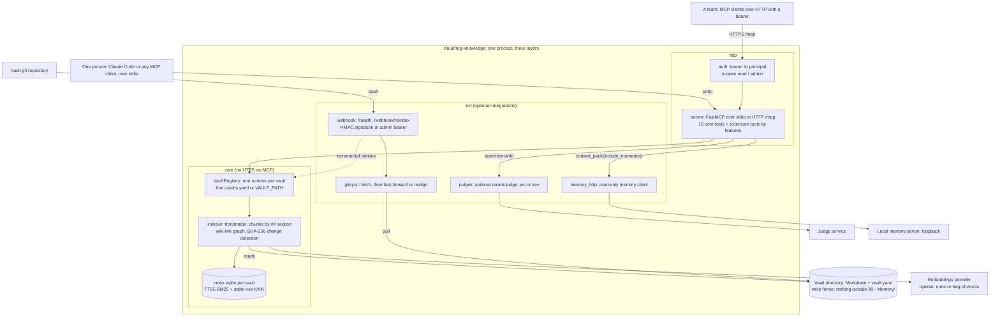

# cloudfrog-knowledge

[](https://github.com/cloudfroghq/knowledge/actions/workflows/ring1.yml)
[](https://pypi.org/project/cloudfrog-knowledge/)
[](https://www.npmjs.com/package/@cloudfrog/knowledge)
[](https://github.com/cloudfroghq/knowledge/blob/main/.python-version)
[](https://github.com/cloudfroghq/knowledge/blob/main/LICENSE)

**A project's curated knowledge (flows, runbooks, endpoints, business rules), answerable from Claude Code or any MCP client.**

`cloudfrog-knowledge` is an [MCP](https://modelcontextprotocol.io) server that serves one or more Obsidian vaults through hybrid search, wiki-link graph navigation and structured metadata queries. It is meant for teams that keep architecture notes, flows, runbooks and API contracts in a vault, and want their coding agents to read the right section instead of re-deriving it from code. One person runs it over stdio against vaults on disk; a team deploys it once and shares it over HTTP with bearer authentication. It is not tied to any project: the vaults it serves are configuration (`KNOWLEDGE_VAULTS` or `VAULT_PATH`). You edit a vault, push, and the server reindexes itself.

**Start here:** [try it offline](#quick-start-offline-about-5-minutes), [use it with your own vault](#use-it-with-your-own-vault), [join a team deployment](https://github.com/cloudfroghq/knowledge/blob/main/docs/team-usage.md), [operate a deployment](https://github.com/cloudfroghq/knowledge/blob/main/docs/operations.md) or [change the code](https://github.com/cloudfroghq/knowledge/blob/main/CONTRIBUTING.md).

## Why

- **Pointers, not pages.** Each `search` row carries `file_path`, `score`, `chunk_id` and `section`, and `get_document(chunk_id=...)` reads only that block. Documents are cut into chunks of about 2,500 characters along `## ` sections with 10% overlap, so an agent spends its context on the answer, not on the whole file.
- **Hybrid search on SQLite, with no vector database.** One `index.sqlite` per vault: BM25 over FTS5 (`unicode61 remove_diacritics 2`) plus exact KNN over float32 vectors with `sqlite-vec`, fused into one score. Without the extension the standard library gives the same results, more slowly. A vault can add a rerank judge with its own budgets.
- **The wiki-link graph as tools.** `find_path`, `get_related` and `get_impact` walk the links between documents, with learned weights; `search_deep` follows them from the search candidates.
- **Several vaults, one process.** A `vaults.yaml` registry serves any number of vaults with one default, each with its own index; every tool takes `vault=<slug>`.
- **A frozen tool contract.** Contract `2.0.0` has golden responses frozen by checksum, and every error is `isError` with a stable `E_` code, never a Python traceback.
- **It never writes your vault** outside `90 - Memory/`. Every tool is tested against a copy of the fixture vault that must stay byte-identical.
- **Ready for a team.** HTTP with `read` and `admin` bearer scopes, a signed push webhook that pulls the vault and reindexes incrementally, a `/health` endpoint, per-tool call telemetry and a `doctor` command.

## How it works


<details>
<summary>The same diagram as Mermaid</summary>



</details>

Each vault is a directory of Markdown, usually a clone of its own git repository. The first tool call that needs the index parses the vault: frontmatter becomes metadata, wiki-links become graph edges, and each chunk is written to the vault's `index.sqlite` with its FTS5 row and its embedding; later reindexes reprocess only files whose SHA-256 changed. A push to the vault's repository reaches `/webhook/reindex`, which brings the clone to the tip of the served branch and reindexes what changed. The modules, their layers and the full flow are in [`docs/architecture.md`](https://github.com/cloudfroghq/knowledge/blob/main/docs/architecture.md).

## Quick start (offline, about 5 minutes)

This runs the server from a clone against a copy of the test vault in `tests/fixtures/vault/`. You need [`uv`](https://docs.astral.sh/uv/) and `git`; nothing else, no network after `uv sync` and no API key: the `bag-of-words` embeddings provider is deterministic and local.

```bash
git clone https://github.com/cloudfroghq/knowledge.git
cd knowledge
uv sync    # creates .venv with Python 3.12 and the dev tools

DEMO="$(mktemp -d)"
cp -r tests/fixtures/vault "$DEMO/vault"     # never point the server at a vault you care about to try it
export VAULT_PATH="$DEMO/vault" KNOWLEDGE_INDEX_DIR="$DEMO/index" KNOWLEDGE_EMBEDDINGS_PROVIDER=bag-of-words
{
  printf '%s\n' \
    '{"jsonrpc":"2.0","id":1,"method":"initialize","params":{"protocolVersion":"2024-11-05","capabilities":{},"clientInfo":{"name":"quickstart","version":"0"}}}' \
    '{"jsonrpc":"2.0","method":"notifications/initialized"}' \
    '{"jsonrpc":"2.0","id":2,"method":"tools/list","params":{}}' \
    '{"jsonrpc":"2.0","id":3,"method":"tools/call","params":{"name":"search","arguments":{"query":"middleware outage","limit":3}}}' \
    '{"jsonrpc":"2.0","id":4,"method":"tools/call","params":{"name":"get_document","arguments":{"chunk_id":"d9bc623bc4:1","max_chars":300}}}' \
    '{"jsonrpc":"2.0","id":5,"method":"tools/call","params":{"name":"list_vaults","arguments":{}}}'
  sleep 5
} | uv run cloudfrog-knowledge serve --transport stdio 2>/dev/null

uv run cloudfrog-knowledge doctor --brief    # knowledge doctor: ok, contract 2.0.0, 1 vault(s), default vault
```

You should see five JSON-RPC responses, one per line: `initialize`, whose `instructions` start with `knowledge-contract: 2.0.0`; `tools/list` with the 10 core tools; a `search` whose first row is `{"file_path":"Runbooks/Runbook - Middleware Outage.md","score":1.06,"chunk_id":"d9bc623bc4:1","section":"Runbook - Middleware Outage"}`; a `get_document` that returns only that chunk; and `list_vaults`. The first `tools/call` builds the index (the log, without `2>/dev/null`, says `Wrote 14 documents (14 chunks)`). Prerequisites, every response in detail and the same server over HTTP are in [`docs/getting-started.md`](https://github.com/cloudfroghq/knowledge/blob/main/docs/getting-started.md).

## Use it with your own vault

**Claude Code, with the plugin (recommended).** The `cloudfroghq` marketplace publishes `knowledge@cloudfroghq` (stdio over your local vaults) and `knowledge-remote@cloudfroghq` (a deployed HTTP server). Prerequisites and the vault registry the plugin reads are in [`docs/install.md`](https://github.com/cloudfroghq/knowledge/blob/main/docs/install.md):

```bash
claude plugin marketplace add cloudfroghq/claude-plugins && claude plugin install knowledge@cloudfroghq --scope user
```

**Claude Code, by hand.** Register the published package over stdio:

```bash
claude mcp add -s user knowledge -e VAULT_PATH=/path/to/your/vault -- \
  uvx --managed-python --python 3.12 cloudfrog-knowledge serve --transport stdio
```

**Any MCP client (stdio).** The same server as a JSON entry; add `OPENAI_API_KEY` to `env` if you keep the default `openai` provider, or set `KNOWLEDGE_EMBEDDINGS_PROVIDER` to `none`:

```json
{
  "mcpServers": {
    "knowledge": {
      "type": "stdio",
      "command": "uvx",
      "args": ["--managed-python", "--python", "3.12", "cloudfrog-knowledge", "serve", "--transport", "stdio"],
      "env": {
        "VAULT_PATH": "/path/to/your/vault",
        "KNOWLEDGE_EMBEDDINGS_PROVIDER": "none"
      }
    }
  }
}
```

The first start can take longer than the 30 s an MCP client waits by default (it downloads the package and, if needed, a managed Python). Run the command once by hand to warm the cache, or raise `MCP_TIMEOUT` in Claude Code.

## Install

The package is published on PyPI (`cloudfrog-knowledge`), on npm (`@cloudfrog/knowledge`) and as a git tag, always with the same version. Every installation provides two commands that are the same program, `knowledge` and `cloudfrog-knowledge`.

| Channel | Command |
|---|---|
| PyPI, run without installing | `uvx --managed-python --python 3.12 cloudfrog-knowledge doctor` |
| PyPI, install the tool | `uv tool install --managed-python --python 3.12 cloudfrog-knowledge`, then `knowledge doctor` |
| npm | `npx @cloudfrog/knowledge doctor` (or `pnpm dlx @cloudfrog/knowledge doctor`, or `npm install -g @cloudfrog/knowledge`) |
| Git tag | `uvx --managed-python --python 3.12 --from git+https://github.com/cloudfroghq/knowledge.git@vX.Y.Z cloudfrog-knowledge doctor` |
| Claude Code plugin | `knowledge@cloudfroghq` (it launches the PyPI release: `uvx --managed-python --python 3.12 --from cloudfrog-knowledge==X.Y.Z cloudfrog-knowledge serve --transport stdio`) or `knowledge-remote@cloudfroghq` |
| Docker / Compose | `infra/compose.yml`, see [Docker image](https://github.com/cloudfroghq/knowledge/blob/main/docs/operations.md#docker-image) |

Keep `--managed-python --python 3.12`: `uv` ignores the upper bound of `requires-python`, and a `uv`-managed CPython loads `sqlite-vec`. Pinning a version, the npm wrapper and every channel in detail: [`docs/install.md`](https://github.com/cloudfroghq/knowledge/blob/main/docs/install.md#install-the-cli).

## Configuration

Configuration is explicit: environment variables (a `.env` at the checkout root never overrides variables already set), the `vaults.yaml` registry and each vault's own `vault.yaml`. Which vaults are served is decided once at startup, in this order:

1. `KNOWLEDGE_VAULTS` (or `serve --vaults FILE`) names a `vaults.yaml`: every vault it declares, with one default.
2. `VAULT_PATH`: a registry of one vault.
3. `$XDG_CONFIG_HOME/knowledge/vaults.yaml` or `~/.config/knowledge/vaults.yaml`, when it exists.
4. None of these: startup fails with `E_VAULT_PATH_MISSING`.

`KNOWLEDGE_EMBEDDINGS_PROVIDER` picks the embeddings:

- `openai` (default): OpenAI embeddings; needs `OPENAI_API_KEY` on the server, never on HTTP clients.
- `none`: lexical (FTS5) search only, no key.
- `bag-of-words`: deterministic and offline, for the test suite and for trying the server; not for real retrieval.

Every environment variable, the `vaults.yaml` format, where each index lives, profiles and `features`, and the `sqlite-vec` fallback are in [`docs/configuration.md`](https://github.com/cloudfroghq/knowledge/blob/main/docs/configuration.md); a full annotated registry is [`vaults.yaml.example`](https://github.com/cloudfroghq/knowledge/blob/main/vaults.yaml.example).

## Tools

The 10 core tools are always served, in this order:

| Tool | What it does |
|---|---|
| `get_document` | Reads one block (`chunk_id` from a `search` row, or `section`), 3,000 characters by default |
| `search` | Hybrid, `semantic` or `keyword` search; each row is a pointer to the block to read |
| `search_by_metadata` | Filters by frontmatter (`type`, `service`, `tag`, `status`), 20 rows per page |
| `search_deep` | `search` plus multi-hop over the wiki-link graph from the candidates |
| `find_path` | Shortest path between two documents |
| `get_related` | Direct neighbors in the graph, in both directions, with their weight |
| `get_impact` | Blast radius of a change through transitive backlinks |
| `reindex` | Reindexes the vault, only what changed; `admin` scope over HTTP |
| `context_pack` | Task context in one call, within a token budget |
| `list_vaults` | The served vaults, the default and the contract version |
| Extensions | `get_flow` and `compare_flows` (`flows`), `get_stale_docs` and `suggest_links` (`governance`), `sync_confluence` (`confluence`) and `sync_jira` (`jira`, stdio only), served only when a vault declares that feature |

`search_code` was retired in contract 2.0.0: it answers `E_TOOL_RETIRED` and points to `graphify` for code relations, `rg` for literal text and `search` for intent. Every parameter, which tool to use when, and tips that save tokens are in [`docs/tools/usage.md`](https://github.com/cloudfroghq/knowledge/blob/main/docs/tools/usage.md).

## CLI

`cloudfrog-knowledge` (or `knowledge`, the same program) has nine subcommands; with none it is `serve`.

- `serve`: starts the MCP server over stdio or HTTP.
- `doctor`: read-only diagnosis of whether this installation can serve; `--brief` prints one line.
- `vault-lint PATH`: checks a vault's frontmatter, wikilinks and rules; JSON on stdout.
- `init`: installs each vault's context packages into the checkouts selected on this machine.
- `migrate-index`: prepares each vault's `index.sqlite` without embedding anything.
- `eval`: runs the retrieval evaluation from a source checkout.
- `confluence export`: writes Confluence pages newer than the vault, outside every vault.
- `memory-bridge sync` and `memory-bridge promote`: publish a vault to the local memory server.
- `jira sync`: copies Jira issues as tasks of the local memory server.

Configuration errors print `<code>: <message>` on stderr, without a traceback, and exit with 2. Flags and exit codes of every command: [`docs/cli.md`](https://github.com/cloudfroghq/knowledge/blob/main/docs/cli.md).

## Run it for a team

Deploy the server once and give each person a bearer. Over HTTP it refuses to start without one; `read` bearers use it and `admin` bearers can also reindex. `infra/compose.yml` is the generic Compose file for every instance, and the push webhook keeps each vault's clone and index current. Start with [`docs/runbooks/serve-multiple-vaults.md`](https://github.com/cloudfroghq/knowledge/blob/main/docs/runbooks/serve-multiple-vaults.md) and [`docs/operations.md`](https://github.com/cloudfroghq/knowledge/blob/main/docs/operations.md); people who query a deployment read [`docs/team-usage.md`](https://github.com/cloudfroghq/knowledge/blob/main/docs/team-usage.md).

## Stability and the tool contract

The tool catalog and every response shape are a versioned contract, today `2.0.0`. The server announces it on the first line of the `initialize` instructions (`knowledge-contract: 2.0.0`), in `list_vaults` and in `GET /health`. Each contract version has golden responses under `tests/golden/v<version>/`, frozen by a `SHA256SUMS` file, and a test fails if a single byte changes. Error codes (`E_...`) are stable. A response shape changes only with a new contract version, recorded in the [contract changelog](https://github.com/cloudfroghq/knowledge/blob/main/docs/contract/CHANGELOG.md); the generated [tool inventory](https://github.com/cloudfroghq/knowledge/blob/main/docs/tools/inventory.md) lists every tool and parameter, and package releases are in [`CHANGELOG.md`](https://github.com/cloudfroghq/knowledge/blob/main/CHANGELOG.md).

## Performance

On a generated 5,000-document vault, the phase 0 and 1 work took a selective `search` from 51.4 to 5.70 ms at p50, a full index build from 18,611 to 6,596 ms, and `doctor --brief` from 812 to 185 ms, with every response byte-identical. Conditions, every table and the trade-offs: [`docs/performance/results-phase-0-1.md`](https://github.com/cloudfroghq/knowledge/blob/main/docs/performance/results-phase-0-1.md).

## Documentation

| Document | What it covers |
|---|---|
| [`docs/getting-started.md`](https://github.com/cloudfroghq/knowledge/blob/main/docs/getting-started.md) | The offline quick start in detail, connecting an MCP client, running over HTTP |
| [`docs/install.md`](https://github.com/cloudfroghq/knowledge/blob/main/docs/install.md) | Team installation: plugins, CLI channels, `init`, bearers, memory bridge, Jira, rerank judge, diagnostics |
| [`docs/configuration.md`](https://github.com/cloudfroghq/knowledge/blob/main/docs/configuration.md) | Vault discovery, `vaults.yaml`, index location, embeddings, profiles, every environment variable |
| [`docs/tools/usage.md`](https://github.com/cloudfroghq/knowledge/blob/main/docs/tools/usage.md) | Every tool, which one to use when, and tips |
| [`docs/cli.md`](https://github.com/cloudfroghq/knowledge/blob/main/docs/cli.md) | Every subcommand, its flags and exit codes, and the command label in hints |
| [`docs/team-usage.md`](https://github.com/cloudfroghq/knowledge/blob/main/docs/team-usage.md) | Connecting to a team deployment, editing and publishing the vault |
| [`docs/operations.md`](https://github.com/cloudfroghq/knowledge/blob/main/docs/operations.md) | Operating a deployment: Docker image, wiring, `/health`, keys, vault sync, troubleshooting, call telemetry |
| [`docs/repository-registry.md`](https://github.com/cloudfroghq/knowledge/blob/main/docs/repository-registry.md) | Where each vault's checkouts are, and how they are resolved |
| [`docs/architecture.md`](https://github.com/cloudfroghq/knowledge/blob/main/docs/architecture.md) | The diagram, the indexing flow and the main modules |
| [`docs/mcp-user-scope-setup.md`](https://github.com/cloudfroghq/knowledge/blob/main/docs/mcp-user-scope-setup.md) | Configuring MCP servers at user scope |
| [`docs/runbooks/serve-multiple-vaults.md`](https://github.com/cloudfroghq/knowledge/blob/main/docs/runbooks/serve-multiple-vaults.md) | Serving several vaults, secrets per instance, the generic Compose file, errors |
| [`docs/runbooks/sync-jira.md`](https://github.com/cloudfroghq/knowledge/blob/main/docs/runbooks/sync-jira.md) | Syncing Jira issues as memory tasks |
| [`docs/runbooks/promote-confluence.md`](https://github.com/cloudfroghq/knowledge/blob/main/docs/runbooks/promote-confluence.md) | Promoting Confluence pages to the vault by PR |
| [`docs/runbooks/ci-ring1.md`](https://github.com/cloudfroghq/knowledge/blob/main/docs/runbooks/ci-ring1.md) | Operating ring 1, required checks, rollback, releases |
| [`docs/tools/inventory.md`](https://github.com/cloudfroghq/knowledge/blob/main/docs/tools/inventory.md) | Generated inventory of every tool (`uv run python scripts/tool_inventory.py`) |
| [`docs/contract/CHANGELOG.md`](https://github.com/cloudfroghq/knowledge/blob/main/docs/contract/CHANGELOG.md) | Tool contract history, version by version |
| [`docs/adr/`](https://github.com/cloudfroghq/knowledge/tree/main/docs/adr) | Architecture decision records (ADR-039 to ADR-050) |
| [`docs/eval/README.md`](https://github.com/cloudfroghq/knowledge/blob/main/docs/eval/README.md) | Retrieval evaluation harness |
| [`docs/performance/`](https://github.com/cloudfroghq/knowledge/tree/main/docs/performance) | Phase 0 and 1 results, the improvement plan, the benchmark harness and SLOs |
| [`scripts/README.md`](https://github.com/cloudfroghq/knowledge/blob/main/scripts/README.md) | Every script in `scripts/` |
| [`lab/README.md`](https://github.com/cloudfroghq/knowledge/blob/main/lab/README.md) | Dockerized lab with fake tenants and clients |
| [`plugin/claude-code/README.md`](https://github.com/cloudfroghq/knowledge/blob/main/plugin/claude-code/README.md) | The `knowledge` plugin for Claude Code |
| [`npm/README.md`](https://github.com/cloudfroghq/knowledge/blob/main/npm/README.md) | The `@cloudfrog/knowledge` npm wrapper |
| [`CHANGELOG.md`](https://github.com/cloudfroghq/knowledge/blob/main/CHANGELOG.md) | Package release history |

## Contributing, security and support

- [CONTRIBUTING.md](https://github.com/cloudfroghq/knowledge/blob/main/CONTRIBUTING.md): development setup, gates, what CI runs, contract rules, commit and PR flow, releases.
- [CODE_OF_CONDUCT.md](https://github.com/cloudfroghq/knowledge/blob/main/CODE_OF_CONDUCT.md)
- [SECURITY.md](https://github.com/cloudfroghq/knowledge/blob/main/SECURITY.md): how to report a vulnerability. Never open a public issue for one.
- [SUPPORT.md](https://github.com/cloudfroghq/knowledge/blob/main/SUPPORT.md): where to ask questions.
- Issues and pull requests use the templates in [`.github/ISSUE_TEMPLATE/`](https://github.com/cloudfroghq/knowledge/tree/main/.github/ISSUE_TEMPLATE) and [`.github/PULL_REQUEST_TEMPLATE.md`](https://github.com/cloudfroghq/knowledge/blob/main/.github/PULL_REQUEST_TEMPLATE.md).

## License

Licensed under the [MIT License](https://github.com/cloudfroghq/knowledge/blob/main/LICENSE). You may use, copy, modify, merge, publish, distribute, sublicense and sell copies of the software, provided the copyright notice and the permission notice in [`LICENSE`](https://github.com/cloudfroghq/knowledge/blob/main/LICENSE) are included in all copies or substantial portions of it. Releases up to 0.9.0 were published under PolyForm Shield 1.0.0 and keep that license; see [`CHANGELOG.md`](https://github.com/cloudfroghq/knowledge/blob/main/CHANGELOG.md).

## Moved from this page

The README used to hold the whole reference. Links to its old sections land here; each one now lives at the link on the right.

| Former section | Now in |
|---|---|
| <a id="contents"></a><a id="features"></a>Contents, Features | GitHub's outline button and [Documentation](#documentation), [Features](#why) |
| <a id="prerequisites"></a><a id="serve-the-fixture-vault-over-stdio"></a><a id="what-you-should-see"></a><a id="connect-it-to-an-mcp-client"></a><a id="run-over-http"></a>Quick start details, Run over HTTP | [Prerequisites](https://github.com/cloudfroghq/knowledge/blob/main/docs/getting-started.md#prerequisites), [Serve the fixture vault over stdio](https://github.com/cloudfroghq/knowledge/blob/main/docs/getting-started.md#serve-the-fixture-vault-over-stdio), [What you should see](https://github.com/cloudfroghq/knowledge/blob/main/docs/getting-started.md#what-you-should-see), [Connect it to an MCP client](https://github.com/cloudfroghq/knowledge/blob/main/docs/getting-started.md#connect-it-to-an-mcp-client), [Run over HTTP](https://github.com/cloudfroghq/knowledge/blob/main/docs/getting-started.md#run-over-http) |
| <a id="installation"></a>Installation | [Installation](https://github.com/cloudfroghq/knowledge/blob/main/docs/install.md#install-the-cli) |
| <a id="which-vaults-are-served"></a><a id="vaultsyaml"></a><a id="where-the-index-lives"></a><a id="embeddings-providers"></a><a id="profiles-and-features"></a><a id="environment-variables"></a><a id="sqlite-vec-and-the-python-fallback"></a>Configuration subsections | [Which vaults are served](https://github.com/cloudfroghq/knowledge/blob/main/docs/configuration.md#which-vaults-are-served), [vaults.yaml](https://github.com/cloudfroghq/knowledge/blob/main/docs/configuration.md#vaultsyaml), [Where the index lives](https://github.com/cloudfroghq/knowledge/blob/main/docs/configuration.md#where-the-index-lives), [Embeddings providers](https://github.com/cloudfroghq/knowledge/blob/main/docs/configuration.md#embeddings-providers), [Profiles and features](https://github.com/cloudfroghq/knowledge/blob/main/docs/configuration.md#profiles-and-features), [Environment variables](https://github.com/cloudfroghq/knowledge/blob/main/docs/configuration.md#environment-variables), [sqlite-vec and the Python fallback](https://github.com/cloudfroghq/knowledge/blob/main/docs/configuration.md#sqlite-vec-and-the-python-fallback) |
| <a id="which-tool-to-use"></a>Which tool to use | [Which tool to use](https://github.com/cloudfroghq/knowledge/blob/main/docs/tools/usage.md#which-tool-to-use) |
| <a id="cli-reference"></a><a id="command-details"></a><a id="command-label-in-hints"></a>CLI reference | [CLI reference](https://github.com/cloudfroghq/knowledge/blob/main/docs/cli.md), [Command details](https://github.com/cloudfroghq/knowledge/blob/main/docs/cli.md#command-details), [Command label in hints](https://github.com/cloudfroghq/knowledge/blob/main/docs/cli.md#command-label-in-hints) |
| <a id="using-a-team-deployment"></a><a id="connect"></a><a id="edit-and-publish-the-vault"></a><a id="if-something-fails"></a>Using a team deployment | [Using a team deployment](https://github.com/cloudfroghq/knowledge/blob/main/docs/team-usage.md), [Connect](https://github.com/cloudfroghq/knowledge/blob/main/docs/team-usage.md#connect), [Edit and publish the vault](https://github.com/cloudfroghq/knowledge/blob/main/docs/team-usage.md#edit-and-publish-the-vault), [If something fails](https://github.com/cloudfroghq/knowledge/blob/main/docs/team-usage.md#if-something-fails) |
| <a id="operating-the-server"></a><a id="what-runs"></a><a id="how-it-is-wired"></a><a id="health-endpoint"></a><a id="generate-the-keys"></a><a id="bearer-scopes"></a><a id="vault-sync"></a><a id="manual-reindex"></a><a id="server-troubleshooting"></a><a id="local-memory-stack-infra"></a>Operating the server | [Operating the server](https://github.com/cloudfroghq/knowledge/blob/main/docs/operations.md), [What runs](https://github.com/cloudfroghq/knowledge/blob/main/docs/operations.md#what-runs), [How it is wired](https://github.com/cloudfroghq/knowledge/blob/main/docs/operations.md#how-it-is-wired), [Health endpoint](https://github.com/cloudfroghq/knowledge/blob/main/docs/operations.md#health-endpoint), [Generate the keys](https://github.com/cloudfroghq/knowledge/blob/main/docs/operations.md#generate-the-keys), [Bearer scopes](https://github.com/cloudfroghq/knowledge/blob/main/docs/install.md#bearers-and-scopes-of-an-http-deployment), [Vault sync](https://github.com/cloudfroghq/knowledge/blob/main/docs/operations.md#vault-sync), [Manual reindex](https://github.com/cloudfroghq/knowledge/blob/main/docs/operations.md#manual-reindex), [Server troubleshooting](https://github.com/cloudfroghq/knowledge/blob/main/docs/operations.md#server-troubleshooting), [Local memory stack (infra/)](https://github.com/cloudfroghq/knowledge/blob/main/docs/operations.md#local-memory-stack-infra) |
| <a id="call-telemetry"></a>Call telemetry | [Call telemetry](https://github.com/cloudfroghq/knowledge/blob/main/docs/operations.md#call-telemetry) |
| <a id="repository-registry"></a>Repository registry | [Repository registry](https://github.com/cloudfroghq/knowledge/blob/main/docs/repository-registry.md) |
| <a id="conditions"></a><a id="search-and-retrieval"></a><a id="reading"></a><a id="indexing"></a><a id="startup-and-cli"></a><a id="trade-offs"></a><a id="deterministic-work-counts"></a><a id="reproduce"></a>Performance tables | [Conditions](https://github.com/cloudfroghq/knowledge/blob/main/docs/performance/results-phase-0-1.md#conditions), [Search and retrieval](https://github.com/cloudfroghq/knowledge/blob/main/docs/performance/results-phase-0-1.md#search-and-retrieval), [Reading](https://github.com/cloudfroghq/knowledge/blob/main/docs/performance/results-phase-0-1.md#reading), [Indexing](https://github.com/cloudfroghq/knowledge/blob/main/docs/performance/results-phase-0-1.md#indexing), [Startup and CLI](https://github.com/cloudfroghq/knowledge/blob/main/docs/performance/results-phase-0-1.md#startup-and-cli), [Trade-offs](https://github.com/cloudfroghq/knowledge/blob/main/docs/performance/results-phase-0-1.md#trade-offs), [Deterministic work counts](https://github.com/cloudfroghq/knowledge/blob/main/docs/performance/results-phase-0-1.md#deterministic-work-counts), [Reproduce](https://github.com/cloudfroghq/knowledge/blob/main/docs/performance/results-phase-0-1.md#reproduce) |
| <a id="tests-and-merge-gates-ring-1"></a>Tests and merge gates (ring 1) | [Tests and merge gates (ring 1)](https://github.com/cloudfroghq/knowledge/blob/main/CONTRIBUTING.md#what-ci-runs) |
| <a id="scripts"></a>Scripts | [Scripts](https://github.com/cloudfroghq/knowledge/blob/main/scripts/README.md) |
