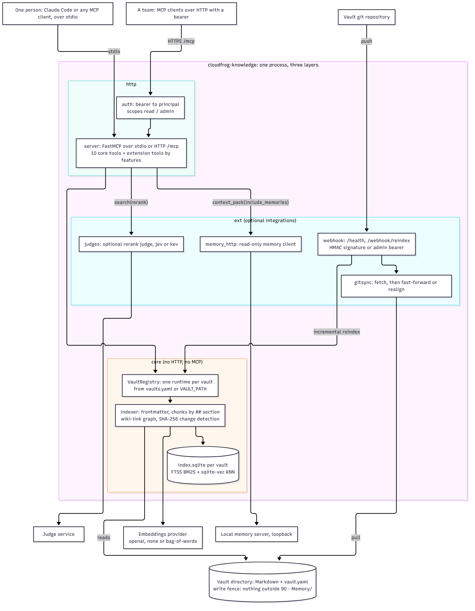

# Knowledge MCP

> El conocimiento curado de un proyecto —flujos, runbooks, endpoints, reglas de negocio— consultable desde Claude Code.
> Editas el vault Obsidian, haces push, y el server se reindexa solo.

Server MCP con búsqueda semántica, navegación por grafo y queries estructuradas sobre un vault Obsidian. Es una base de memoria reutilizable: el vault que sirve lo decide `VAULT_PATH`, y ningún proyecto está cableado en el código. Corre en un servidor y se expone al equipo vía HTTP con Bearer auth, o local en stdio para desarrollo.

**¿Qué necesitas leer?**

| Si eres… | Ve a |
|---|---|
| Alguien del equipo que quiere consultar y editar el conocimiento | [Para el equipo](#para-el-equipo) |
| Quien administra el server | [Operar el server](#operar-el-server) |
| Quien toca el código de este repo | [Contribuir](#contribuir) |

---

# Para el equipo

## 1. Conectarte

La instalación por plugins de Claude Code (marketplace `cloudfroghq`, una línea por equipo) está en [`docs/install.md`](docs/install.md). Lo que sigue es el registro manual.

**El CLI en tu terminal** (`init`, `doctor`, `vault-lint`…): el paquete se publica en PyPI, en npm y como tag de git, siempre con la misma versión, y deja dos comandos que son el mismo programa, `knowledge` y `cloudfrog-knowledge`.

```bash
uv tool install --managed-python --python 3.12 cloudfrog-knowledge   # PyPI; después: knowledge doctor
uvx --managed-python --python 3.12 cloudfrog-knowledge doctor        # PyPI, sin instalar
npx @cloudfrog/knowledge doctor                                      # npm (o pnpm dlx @cloudfrog/knowledge doctor)
uvx --managed-python --python 3.12 --from git+https://github.com/cloudfroghq/knowledge.git@v0.8.0 cloudfrog-knowledge doctor   # tag de git
```

El paquete de npm descarga un `uv` fijo, verificado por SHA-256, y corre con él la versión de PyPI que le corresponde. Detalle y requisitos en [`docs/install.md`](docs/install.md), «Instalar el CLI».

Pide a quien administra el stack dos credenciales, por canal seguro y nunca por git: la `MCP_API_KEY` del knowledge MCP y el `MEMORY_CLOUD_TOKEN` de memory.

Son dos piezas con roles distintos, y conviene entender la diferencia antes de instalar nada:

- **cloudfrog-knowledge** (MCP remoto, HTTP): el conocimiento curado del proyecto. Te conectas al server central, no instalas nada.
- **memory** (binario local + MCP stdio): la memoria episódica de TU agente — decisiones, bugs, contexto de sesión. Es local-first: vive en tu máquina y se **replica** al cloud compartido para respaldo y conocimiento común. El container remoto NO es un MCP al que te conectas.

**Knowledge MCP** (una línea):

```bash
claude mcp add -s user -t http cloudfrog-knowledge https://<despliegue>/mcp -H "Authorization: Bearer <token>"
```

`<token>` es la `MCP_API_KEY` del despliegue, de solo lectura; un despliegue que sirve por HTTPS cifra el bearer. `reindex` y `sync_confluence` exigen el alcance `admin`, que da la `MCP_ADMIN_KEY`. La URL de cada despliegue y cómo pedir su bearer están documentadas en su vault, en `Deploy/`.

**memory local** (macOS o Linux, mismo comando):

El repo `horacioespinosa/memory` es **privado**, así que `gh` tiene que estar autenticado con una
cuenta que lo pueda leer. Descarga el binario del release y verifica su checksum antes de
instalarlo:

```bash
gh release download <version> --repo horacioespinosa/memory \
  --pattern 'memory_*_darwin_arm64.tar.gz' --pattern checksums.txt
grep darwin_arm64 checksums.txt | shasum -a 256 -c -
tar xzf memory_*_darwin_arm64.tar.gz memory
sudo mv memory /usr/local/bin/memory
memory setup claude-code
```

Cambia `darwin_arm64` por tu plataforma (`darwin_amd64`, `linux_amd64`, `linux_arm64`). Detalle
completo en [docs/INSTALLATION.md del fork](https://github.com/horacioespinosa/memory/blob/main/docs/INSTALLATION.md).

`brew install cloudfroghq/tap/memory` llegará cuando exista el tap `cloudfroghq/homebrew-tap`;
hasta entonces no hay fórmula de Homebrew que funcione para este fork. Tampoco uses
`gentleman-programming/tap/engram`: es el tap del proyecto **original** del que sale este fork, y
te instala ese proyecto sin el arreglo del backfill ni la configuración de cloud de este equipo,
sin que nada te avise.

El setup registra el MCP stdio y los hooks de sesión. Verifica con `memory doctor`.

**Conectar tu memory al cloud del equipo**:

```bash
memory cloud config --server https://<memory-cloud-del-equipo>
memory cloud enroll knowledge-mcp
MEMORY_CLOUD_TOKEN=<token> memory sync --cloud --project knowledge-mcp
```

El sync es bidireccional: empuja tus memorias y trae las de tus compañeros (revisa `Pending import` en `memory sync --cloud --status --project knowledge-mcp`). Repítelo cuando quieras compartir o recibir, o automatízalo con un cron semanal.

Convenciones de memoria compartida (ver `docs/TEAM-USAGE.md` del repo de memory):

- `scope: project` = conocimiento útil para el equipo (decisiones, bugfixes, gotchas). `scope: personal` NO queda fuera del sync — si es realmente personal, guárdalo bajo otro nombre de proyecto no enrolado.
- Guarda las memorias de proyecto en un solo idioma común: la búsqueda de memory es léxica (FTS5) y no cruza idiomas.

Reinicia Claude Code y listo.

## 2. El vault: editarlo y publicarlo

El vault no vive en este repositorio: cada organización tiene el suyo, en su propio repositorio. Clona el del vault que vas a editar:

```bash
git clone git@github.com:<org>/vault.git ~/Projects/Vaults/<slug>
```

Lo abres en Obsidian, editas y propones el cambio por PR con el dueño del vault como revisor (D-11). Cuando el PR entra a `main`, el webhook de push de ese repositorio avisa al server, que trae los cambios y reindexa solo lo que cambió.

Un commit de un archivo cuesta ~$0.0003 en embeddings. Edita sin miedo.

## 3. Cómo buscar

La diferencia entre "tenemos un MCP" y "el equipo lo usa" está en saber cuál herramienta pedir. Guía rápida:

| Quiero… | Usa | Ejemplo |
|---|---|---|
| Encontrar algo por tema | `search` | `search "provisioning de tenant"` |
| Lo mismo, pero el tema está repartido entre docs enlazados | `search_deep` | `search_deep "facturación de una suscripción" depth=2` |
| Leer un doc sin quemar tokens | `get_document` | `get_document "Runbooks/Troubleshooting.md" section="API calls fail"` |
| Saber cómo se conectan dos cosas | `find_path` | `find_path "Modules/Billing/Billing.md" "Modules/Provisioning/Provisioning.md"` |
| Saber qué se rompe si cambio algo | `get_impact` | `get_impact "Architecture/Data Model Overview.md"` |
| Ver los vecinos de un doc | `get_related` | `get_related "Modules/Billing/Billing.md"` |
| Filtrar por tipo o servicio | `search_by_metadata` | `search_by_metadata type="runbook"` |
| Buscar relaciones o impacto de un símbolo real en el código | `graphify explain` / `graphify affected` (`search_code`, retirada en 2.0.0, redirige aquí: ADR-039) | `graphify explain "verifyStorageAccess"` |
| Buscar texto literal en código, plantillas o QML | `rg` | `rg "verifyStorageAccess"` |
| Comparar flujos de auth entre providers | `compare_flows` | `compare_flows "<proveedor-a>" "<proveedor-b>"` |

**Dos consejos que ahorran tokens y frustración:**

- `get_document` lee hasta 3.000 caracteres por defecto; si el texto sigue, la respuesta trae `truncated: true` y `next_offset`. Lee el `chunk_id` de una fila de `search` o una `section="..."` en lugar de subir `max_chars`: un bloque es una fracción de un documento grande.
- Si `search` devuelve algo que casi sirve, no repitas la búsqueda con otras palabras — prueba `search_deep`, que sigue los wiki-links desde los candidatos.
- Si el vault declara un juez (`rerank` en su `vault.yaml`), `search(query, rerank="on")` reordena los resultados con él: cada fila que el juez leyó trae `rerank_score` (la probabilidad de que su bloque responda la consulta) y `chunk_id`/`section` apuntan a ese bloque. Con `rerank.default: on` pasa sin pedirlo y `rerank="off"` lo evita. Un juez caído nunca rompe la búsqueda: responde sin rerank y `_meta["knowledge/rerank"].reason` dice por qué.

**Mantenimiento del vault** (si te toca curar contenido):

| Tool | Para qué |
|---|---|
| `get_stale_docs` | Cola de revisión con su dueño. Cada fila trae `reason`: `overdue` (con `age_days`) o `last_updated_invalid` (sin `age_days`, porque no hay antigüedad que calcular). Filtra con `owner="plat"`, o pide `include_unreadable=false` para ver solo lo vencido. |
| `suggest_links` | Propone wiki-links faltantes entre docs que comparten vecinos. |
| `sync_confluence` | Informa qué archivos bajo `scope_prefix` tienen una página de Confluence más nueva. Solo lectura: `dry_run=False` responde `E_WRITE_FENCED`; la exportación la hace `cloudfrog-knowledge confluence export` fuera del vault, para un PR. Requiere `CONFLUENCE_EMAIL` + `CONFLUENCE_TOKEN` (o los nombres de `integrations.confluence.secrets` del `vault.yaml`). |
| `reindex` | Fuerza un reindex. Detecta cambios por hash SHA-256, solo re-procesa lo modificado. |
| `sync_jira` | Solo por stdio y solo si un vault servido declara la extensión `jira`: copia los issues de los proyectos de `integrations.jira` como tareas del proyecto de memory del vault (upsert por `jira_key`). `dry_run=True` (por omisión) solo lee Jira. Ver `docs/runbooks/sincronizar-jira.md`. |

## 4. Si algo falla

**Las tools no aparecen en Claude Code.** Reinicia Claude Code después de registrar el MCP. Verifica el registro con `claude mcp get cloudfrog-knowledge`.

**Recibes 401.** El Bearer que registraste no coincide con la `MCP_API_KEY` del server. Revisa el header con `claude mcp get cloudfrog-knowledge` y pide la key correcta a quien administra.

**Las respuestas traen demasiado texto.** Usa `get_document(section="...")` o `max_chars=500`.

**Editaste el vault y no aparece en las búsquedas.** Revisa que el push haya llegado, y consulta el estado del índice:

```bash
curl -s https://<despliegue>/health
```

`last_indexed_at` debe ser posterior a tu push. Si `indexing` es `true`, está trabajando: espera y vuelve a mirar.

---

# Operar el server

Cada despliegue es una instancia del mismo servidor con su propio entorno: sus vaults, su índice, sus claves y su dominio. Lo propio de cada uno —dominio, aplicación en la plataforma, claves por nombre, webhooks, rollback— se documenta en su vault, en `Deploy/`; aquí solo está lo común.

## Qué corre

`infra/compose.yml` es el compose de todas las instancias (el procedimiento de vaults y entradas está en `docs/runbooks/servir-varios-vaults.md`, «Compose genérico»):

- **knowledge-mcp** — build de este repo, sin puertos publicados: una plataforma enruta al puerto 8000 del contenedor, y quien usa `docker compose` a mano publica con un override.
- **memory-cloud** (perfil `memory`) — imagen `ghcr.io/horacioespinosa/memory`, tag en la variable `MEMORY_IMAGE_TAG` (default `latest`) y `pull_policy: always`, sin puertos publicados. El paquete de GHCR es privado: el pull exige una credencial de registro cargada en la plataforma.
- **Postgres** (perfil `memory`) — interno, sin puerto expuesto.

`infra/dokploy-compose.yml` es el compose de un despliegue en Dokploy que todavía no migra a `infra/compose.yml`; se documenta en el vault de ese despliegue.

## Cómo está cableado

Por si hay que recrearlo:

1. **Fuente**: la plataforma construye este repo con `infra/compose.yml` (conexión GitHub sobre `cloudfroghq/knowledge`, branch `main`). El despliegue automático **por sí solo no despliega nada** en Dokploy: el servidor no registra el webhook, hay que crearlo a mano en GitHub (ver punto 4). Si falta, los push entran al repo y el server sigue corriendo la imagen vieja, sin ningún error visible.

2. **Vaults en runtime**: ningún vault vive en este repo. `KNOWLEDGE_VAULTS_YAML` lleva un `vaults.yaml` con las entradas de cada instancia (un `repo` que el entrypoint clona en `/data/vaults/<slug>`, o una carpeta montada con `path`), y en modo de un solo vault `VAULT_REMOTE`, `VAULT_BRANCH` y `VAULT_PATH`. El clon necesita una deploy key de solo lectura (`GIT_DEPLOY_KEY_B64`, o una por vault). Los umbrales de revisión salen del `vault.yaml` del vault, así que no se monta ningún `config.json` (`KNOWLEDGE_CONFIG_JSON` no se define). Si el volumen ya tiene un clone, el arranque reapunta su remote, hace `fetch` y fuerza el checkout de la rama, así que un volumen viejo adopta el remoto nuevo con su contenido. Después del clone el arranque verifica que `VAULT_PATH` exista y aborta nombrando la ruta, el remoto y la rama si falta: un remoto cuyo árbol no trae ese directorio muere en la validación de `config.py` y, con `restart: unless-stopped`, queda en crashloop detrás de un deploy que reporta éxito.

   **Índice**: vive en el volumen `knowledge-index`, en `KNOWLEDGE_INDEX_DIR=/data/index/<slug>` (`index.sqlite` con sus sidecars `link_graph.json`, `usage_stats.json`, `index_meta.json` y `skipped_files.json`). El arranque corre `migrate-index` y recién después `serve`; `migrate-index` no embebe nada: crea `index.sqlite` y, si encuentra un índice de Chroma en `/data/chroma` (un volumen montado solo como origen), copia sus estadísticas de uso y los pesos aprendidos del grafo. El índice se llena en la primera tool o con el webhook. Después del despliegue, `docker volume ls` debe listar el volumen `knowledge-index` y `/health` debe traer `index_version`.

3. **Env del compose** (en el panel de la plataforma, nunca en git): `MCP_API_KEY` (bearer de lectura de los clientes), `MCP_ADMIN_KEY` (bearer `admin`, distinto del anterior: el único que puede llamar `reindex`, `sync_confluence` o `POST /webhook/reindex` con bearer manual), `MCP_WEBHOOK_SECRET`, `OPENAI_API_KEY` (solo aquí — los clientes nunca la tocan), `<SLUG>_TYPESAFE_API_KEY` (opcional: la clave del juez de `search`, con el nombre que declara el `vault.yaml` del vault), `GIT_DEPLOY_KEY_B64`, y con el perfil `memory`: `POSTGRES_PASSWORD`, `MEMORY_JWT_SECRET`, `MEMORY_CLOUD_TOKEN`, `MEMORY_CLOUD_ADMIN`, `MEMORY_CLOUD_TOKEN_PEPPER`. Además, sin valor secreto: `MEMORY_IMAGE_TAG`, que fija el tag de la imagen del cloud; sin ella el compose usa `latest`, el tag móvil, y el rollback es darle una versión publicada exacta, por ejemplo `v1.0.3`. `MEMORY_CLOUD_IDENTITY_MODE`, el modo de identidad de memory-cloud (memory 1.7.0 o posterior): `grace` por omisión acepta el `MEMORY_CLOUD_TOKEN` compartido junto a los tokens personales; `required` lo rechaza en `/sync/*` con `401 identity_required` y deja el dashboard solo a administradores. Para cambiarlo se define en el panel y se vuelve a desplegar; una imagen anterior a 1.7.0 la ignora. Y una credencial de registro para `ghcr.io`, porque el paquete es privado.

   Dos variables de `memory-cloud` **no** se cargan en el panel porque el compose las fija dentro del servicio: `MEMORY_CLOUD_ALLOWED_PROJECTS: "*"` (servidor de un solo usuario detrás del bearer, replica todo proyecto inscrito en lugar de filtrar por nombre) y `MEMORY_PROJECTS_SYNC: "1"` (habilita la réplica de cards de proyecto, tareas y evidencia). Un valor puesto en el panel para cualquiera de las dos no llega al container.

4. **Dos webhooks en GitHub** (Settings → Webhooks), ambos con trigger de push y cada uno en su repo:
   - **reindex**, en el repositorio del vault → `https://<dominio>/webhook/reindex?target=vault`, content type `application/json`, con Secret = `MCP_WEBHOOK_SECRET`. Push al vault → pull del clon → reindex incremental.
   - **deploy**, en `cloudfroghq/knowledge` → la URL de deploy que expone la plataforma para este compose, sin secret: el token de la URL autentica. Push al código → redeploy.

   **Revisa el historial de entregas de cada uno.** Sin ese registro, un webhook que entrega bien se ve exactamente igual que uno que nunca dispara.

5. **Healthcheck**: `GET /health` responde cuatro señales distintas, y conviene no confundirlas:

   | Campo | Significa |
   |---|---|
   | `indexed` | Documentos en disco. Siempre disponible. |
   | `index_loaded` | Si este proceso ya cargó el índice. Arranca en `false` tras cada deploy; no indica pérdida de datos. |
   | `indexing` | Si hay un reindex corriendo ahora mismo. |
   | `stale` / `last_indexed_at` | Si el vault cambió después del último indexado. |
   | `index_version` / `vector_backend` | Formato del `index.sqlite` y quién ordena los vectores: `sqlite-vec` o `python` (respaldo de la biblioteca estándar, más lento, cuando la extensión no carga). |
   | `vault_commit` | Commit abreviado (12 caracteres) que tiene el clon del vault ahora mismo; se lee en cada llamada, así que es correcto desde el arranque. `null` si el vault no declara repositorio. |
   | `last_sync_at` / `last_sync_result` / `last_sync_error` | Cuándo y cómo terminó la última actualización del clon en este proceso: `fast_forward`, `up_to_date`, `realigned` (historia reescrita o divergente: el clon se alineó con el remoto) o `failed`, con el motivo en `last_sync_error` (una línea, sin credenciales). `null` antes de la primera actualización tras el arranque y en un vault sin repositorio. Un `failed` no cambia `status`: el vault se sigue sirviendo desde disco. |
   | `last_change_at` / `last_change_result` | Cuándo y cómo terminó la última actualización que movió el clon en este proceso: `fast_forward` o `realigned`. Un `up_to_date` o un `failed` posterior no la reemplaza, así que un merge que se trajo sigue visible aunque después llegue una pasada sin nada nuevo. `null` hasta el primer cambio tras el arranque y en un vault sin repositorio. |

6. **Dominios y TLS**: el compose no publica puertos; la plataforma enruta el dominio al puerto 8000 del contenedor y emite el certificado. El dominio, su DNS y el certificado de cada despliegue se documentan en su vault, en `Deploy/`.

## Generar las API keys

```bash
openssl rand -hex 32   # MCP_API_KEY (clientes)
openssl rand -hex 32   # MCP_WEBHOOK_SECRET (webhook del repo)
```

## Sync del vault

El server mantiene su propio clone de cada vault con repositorio (en `/data/vaults/<slug>` con el compose genérico) y reindexa en respuesta a los webhooks.

1. **En tu máquina**: editas el vault y haces push (o el plugin Obsidian Git commitea cada N minutos).
2. **GitHub** entrega el webhook de push.
3. **Container**: `/webhook/reindex` valida el HMAC (`X-Hub-Signature-256`, o `X-Hub-Signature` cuando trae un digest `sha256=`, como el de Bitbucket), lleva el clon del vault a la punta de la rama servida en `origin` y dispara el reindex incremental. Costo por commit de un archivo: ~$0.0003 en OpenAI.
   - El clon converge con el remoto pase lo que pase arriba: `git fetch --prune origin`; si `HEAD` es ancestro de `origin/<rama>` (el push normal), `git merge --ff-only`; si no (la rama se reescribió con un force push, el clon divergió o el fast-forward se rechaza), `git checkout -f -B <rama> origin/<rama>`, el mismo comando con el que `infra/bootstrap-vault.sh` adopta un clon al arrancar, con un `WARNING` en el log que nombra el commit viejo y el nuevo. Los archivos sin seguimiento se quedan, como en el bootstrap. Si el `fetch` falla (llave, red), el clon no se toca, el log lleva un `ERROR`, se indexa lo que hay en disco y `/health` lo dice en `last_sync_result: failed`.
   - Solo un push a la rama servida (`git.branch` en `vaults.yaml`, `VAULT_BRANCH` con `VAULT_PATH`; `main` por omisión) trae algo al clon. Un push firmado a otra rama o a un tag, o que borra una rama (el que manda `--delete-branch` al mergear, o «Close source branch» al mergear en Bitbucket), recibe 200 con `"status": "ignored"` y no corre ni git ni reindex. Un `repo:push` de Bitbucket Cloud no trae `ref`: se juzga por `push.changes` y corre solo si algún cambio deja la rama servida en un commit (`new` de tipo `branch` con ese nombre).
   - Las entregas seguidas no se pisan: mientras corre un pull+reindex de un vault, las que llegan suman una sola pasada más al terminar, que trae lo último del remoto. La tool `reindex` toma el mismo candado, así que nunca corren dos actualizaciones de git en el mismo clon.

### Reindex manual

Para forzar un reindex sin commit (la ruta existe solo cuando el vault por defecto declara un repositorio, `repo` en `vaults.yaml` o `VAULT_REMOTE`; sin él, responde 404 y el reindex se pide con la tool `reindex`). El bearer necesita el alcance `admin`: `MCP_ADMIN_KEY` cuando está definida, o `MCP_API_KEY` cuando no hay alcances configurados; un bearer de solo lectura recibe 403 con `E_SCOPE_REQUIRED`:

```bash
curl -X POST -H "Authorization: Bearer $MCP_ADMIN_KEY" \
  "https://<dominio>/webhook/reindex?target=vault"
```

> [!important] Un reindex completo hace falta una sola vez
> Los metadatos del chunk incluyen `owner` y `last_verified`. El reindex
> incremental salta los archivos cuyo hash no cambió, así que un índice
> construido antes de que existieran esos campos no los tiene y
> `get_stale_docs` devolvería `unassigned` para todo.
>
> Se arregla con un reindex forzado, y hay dos vías:
>
> - la tool MCP `reindex` con `force=true`;
> - `POST /webhook/reindex?force=true`, **solo** con el Bearer manual de
>   alcance `admin`. Un push del repositorio se autentica por firma HMAC y no
>   puede pedir `force`: una corrida completa de embeddings sobre todo el
>   vault no se dispara sola desde un commit.
>
> El reporte semanal (`scripts/weekly-stale-report.py`) no depende del índice
> y funciona desde el primer minuto.

## Variables de entorno

Todas opcionales en stdio; las HTTP solo aplican con `MCP_TRANSPORT=http`.

| Variable | Default | Notas |
|----------|---------|-------|
| `OPENAI_API_KEY` | — | Requerida en el server cuando el proveedor de embeddings es `openai`. Los clientes HTTP no la necesitan. |
| `KNOWLEDGE_EMBEDDINGS_PROVIDER` | `openai` | `openai`, `none` o `bag-of-words`. Con `none` el server arranca sin `OPENAI_API_KEY`. |
| `KNOWLEDGE_STRUCTURED_OUTPUT` | `0` | Los bloques de texto son la respuesta canónica. `1` añade `outputSchema` a cada tool y `structuredContent` a cada respuesta, el mismo JSON que el texto; el orden del catálogo no cambia. Ver `docs/adr/ADR-046.md`. |
| `KNOWLEDGE_PROFILE` | `all` | Perfil de tools del proceso: `all` (el núcleo y las tools de extensión que declaren los vaults servidos) o `legacy` (los 16 nombres de 1.4.0 en su orden, con `search_code`, durante una release). `serve --profile` gana sobre la variable; otro valor detiene el arranque con `E_PROFILE_UNKNOWN`. |
| `KNOWLEDGE_TEXT_INDENT` | — | Sin definir, el texto de cada respuesta es JSON compacto; un entero de 1 a 8 lo sangra (`2` reproduce el texto del contrato 1.0.0). |
| `MCP_TRANSPORT` | `stdio` | `http` para deploy remoto. |
| `MCP_API_KEY` | — | Bearer requerido en cada request `/mcp` cuando `MCP_TRANSPORT=http`. Sin `MCP_ADMIN_KEY` tiene los alcances `read` y `admin`; con ella, solo `read`. Se ignora si `vaults.yaml` declara `bearers`. |
| `MCP_ADMIN_KEY` | — | Bearer con alcance `admin` (`read` y `admin`): el único que puede llamar `reindex`, `sync_confluence` y `POST /webhook/reindex` con bearer manual. Debe ser distinta de `MCP_API_KEY` (si coinciden, el arranque sale con `E_MANIFEST_INVALID`). Se ignora si `vaults.yaml` declara `bearers`, y por stdio no se usa. |
| `MCP_WEBHOOK_SECRET` | — | HMAC del webhook. Si no se setea, el webhook solo acepta Bearer manual. La ruta `/webhook/reindex` existe solo con `VAULT_REMOTE` (o `repo` en `vaults.yaml`). |
| `MCP_HTTP_HOST` | `0.0.0.0` | |
| `MCP_HTTP_PORT` | `8000` | |
| `MCP_HTTP_PATH` | `/mcp` | |
| `VAULT_PATH` | `vault_path` del `config.json`, si existe | Directorio del vault (un clon de su repositorio). Sin ella ni `KNOWLEDGE_VAULTS`, se sirve el `vaults.yaml` del usuario y, sin él, el arranque falla con `E_VAULT_PATH_MISSING`. Vacía equivale a ausente: nunca resuelve a la raíz del checkout. |
| `KNOWLEDGE_INDEX_DIR` | — | Directorio del índice (`index.sqlite` y sus sidecars) de un vault servido con `VAULT_PATH`. Gana sobre las dos siguientes. |
| `CHROMA_PERSIST_DIR` | — | Directorio de un índice de Chroma: `migrate-index` copia de ahí estadísticas de uso y pesos del grafo. Sin `KNOWLEDGE_INDEX_DIR`, también es el directorio del índice (`index.sqlite` junto a `chroma.sqlite3`). |
| `KNOWLEDGE_HOME` | — | Raíz de datos: sin `KNOWLEDGE_INDEX_DIR` ni `CHROMA_PERSIST_DIR`, el índice vive en `<KNOWLEDGE_HOME>/<slug>`; sin ninguna, en `<checkout>/.data/<slug>`. |
| `KNOWLEDGE_REQUIRE_SQLITE_VEC` | — | Con `1`, si la extensión `sqlite-vec` no carga en este Python, el servidor y la suite fallan con `E_SQLITE_VEC_UNAVAILABLE` en lugar de ordenar los vectores con el respaldo de la biblioteca estándar (`vector_backend: python`, unas diez veces más lento). Ring1 y la grabación de goldens lo fijan. |
| `KNOWLEDGE_CONFIG_JSON` | `<checkout>/config.json`, si existe | Archivo de configuración estática (el repositorio no trae ninguno). |
| `CONFLUENCE_URL` | `confluence.url` del `config.json`, si existe | Raíz del sitio de Atlassian (`https://<org>.atlassian.net`), **sin** `/wiki`: el cliente añade `/wiki/api/v2` por su cuenta, y con `/wiki` al final cada página responde 404. Un vault la reemplaza con `integrations.confluence.site`. |
| `CONFLUENCE_EMAIL` / `CONFLUENCE_TOKEN` | — | Solo para `sync_confluence` y `confluence export`. Un vault puede nombrar otras variables en `integrations.confluence.secrets` (`email_env`, `token_env`), siempre de Confluence y con su propio prefijo (`<SLUG>_CONFLUENCE_EMAIL`, `<SLUG>_CONFLUENCE_TOKEN`; sin prefijo, solo el vault por defecto), y el sitio en `integrations.confluence.site` (`https` en `*.atlassian.net` o en `KNOWLEDGE_INTEGRATION_SITES`); otro nombre o sitio es `E_MANIFEST_INVALID`. |
| `KNOWLEDGE_INTEGRATION_SITES` | — | Hosts que `integrations.<confluence\|jira>.site` puede nombrar además de `*.atlassian.net`, separados por comas: un host exacto o `.dominio` para los que cuelgan de él. La define el operador; un vault nunca la amplía. |
| `KNOWLEDGE_MEMORY_URL` | `http://127.0.0.1:6366` | Servidor de memory local. Solo se usa si es `http` sobre `127.0.0.1`, `localhost` o `::1`: otra URL apaga lecturas (`E_MEMORY_URL_NOT_LOOPBACK`) y escrituras. |
| `MEMORY_HTTP_TOKEN` | — | Bearer de memory. Sin él, `context_pack(include_memories=true)` no lee memory y `memory-bridge` no escribe. |
| `KNOWLEDGE_MEMORY_REQUIRE_TOKEN` | `1` | Solo para las escrituras de `memory-bridge` (y de `jira`): con exactamente `0`, escriben sin `MEMORY_HTTP_TOKEN` en un memory local que corre sin token. Cualquier otro valor lo exige. Las lecturas siempre lo exigen. |
| `MEMORY_BIN` | `memory` en el `PATH` | Binario de memory que corre `memory-bridge promote`. |
| `<PREFIJO>_JIRA_EMAIL` / `<PREFIJO>_JIRA_TOKEN` | — | Solo para `sync_jira` y `jira sync`: el correo de la cuenta de Jira y su API token, con los nombres que declara `integrations.jira.secrets` (`email_env`, `token_env`) del `vault.yaml`, con el `slug` del vault como prefijo, por ejemplo `ACME_JIRA_EMAIL` y `ACME_JIRA_TOKEN` para `acme` (sin prefijo, como `JIRA_API_TOKEN`, solo el vault por defecto). Viven en el entorno de la persona (stdio), nunca en un despliegue. |
| `KNOWLEDGE_JIRA_AUTOSYNC` | `1` | Con `0`, el hook de sesión del plugin no lanza `jira sync --auto` en segundo plano. |
| `TYPESAFE_API_KEY` / `<PREFIJO>_TYPESAFE_API_KEY` | — | Clave del juez `jev` de TypeSafe, con el nombre que declara `rerank.key_env` del `vault.yaml` (sin prefijo, solo el vault por defecto). Sin ella el servidor arranca igual, por stdio y por HTTP, con `W_RERANK_KEY_MISSING`, y ese vault busca sin juez (`reason: key_missing`). Costo medido: 0,042 USD por millón de tokens de entrada, unos 11.700 tokens por búsqueda reordenada, es decir ≈0,0005 USD por búsqueda; `rerank.max_usd_per_day` (1,00 por omisión) es el tope por vault y por día, compartido por todos los procesos del vault. Si la plataforma guarda la clave bajo un nombre corto, el compose la copia al nombre que declara el vault. |
| `KEV_API_KEY` / `<PREFIJO>_KEV_API_KEY` | — | Clave del juez `kev` local (solo `http` en loopback), cuando el servidor de Kev la pide. Kev no cuesta. |
| `KNOWLEDGE_RERANK` | — | `off` apaga el juez de todos los vaults del proceso: `search` responde sin rerank con `reason: disabled`. Vacía o ausente, manda cada vault. Cualquier otro valor también lo apaga y avisa con `W_RERANK_INVALID`. |
| `KNOWLEDGE_RERANK_PROVIDERS` | `jev,kev` | Proveedores que el operador permite; un vault que declara otro busca sin juez. |
| `KNOWLEDGE_RERANK_BASE_URL` | — | Reemplaza la URL de todo juez: `https://api.typesafe.ai` o un `http` en loopback (lo usa la suite con su doble de System One). Ningún vault puede cambiarla. |
| `KNOWLEDGE_RERANK_TIMEOUT_MS` | `rerank.timeout_ms` del vault (1.500) | Plazo total de cada llamada al juez, de 200 a 60.000 ms: resolución DNS, conexión, TLS y lectura. Vencido, `search` responde sin rerank con `reason: timeout`. |
| `KNOWLEDGE_<RAÍZ>_ROOT` | desde `repos.local.json` | Fija una raíz completa, por ejemplo `KNOWLEDGE_WORK_ROOT`. `CD_<RAÍZ>_ROOT` y el `env` que declare la raíz siguen funcionando como alias obsoletos, y `python3 -m knowledge.repos --json` los reporta en `warnings`. Ver el registro de repositorios. |
| `KNOWLEDGE_REPO_<ID>` | desde la raíz correspondiente | Fija un checkout concreto, por ejemplo `KNOWLEDGE_REPO_LEDGER_API`. `CD_REPO_<ID>` sigue funcionando como alias obsoleto. |

## Registro de repositorios

Ninguna ruta de repositorio se escribe en el código. El mapeo repositorio → ruta
vive en un solo lugar y todos los consumidores lo leen desde ahí.

| Archivo | Qué declara | ¿Versionado? |
|---|---|---|
| `<vault>/Contexts/config.json` → `repos` (y `graph`) | Qué **es** cada repositorio: su identificador, el grupo al que pertenece, el remoto que lo prueba, la ruta relativa que ocupa bajo una raíz y el paquete de contexto (`Contexts/<context>/`) que le corresponde. Igual en todas las máquinas. | Sí, con el vault |
| `~/.config/knowledge/<slug>/repos.local.json` | Dónde **están** las raíces en esta máquina, y el directorio del vault. Rutas absolutas. También `apply`, la lista de los identificadores cuyos paquetes de contexto instala `init` en esta máquina (`--repo`, `--all` y `--drop` la cambian; ni los objetivos del grafo ni el servidor la leen). Lo escribe `cloudfrog-knowledge init` (con `$XDG_CONFIG_HOME` si está definida). | No: vive fuera de todo repositorio |

El servidor no viene casado con ningún proyecto: los checkouts que puede
alcanzar los declara cada vault en su `Contexts/config.json`, una entrada por
checkout. La fixture `tests/fixtures/vaults/contexts/Contexts/config.json` muestra
la forma y `docs/adr/ADR-047.md` explica cada campo que el parser exige.

**La clave es la identidad del repositorio**, nunca el nombre del directorio
local. Las dos cosas pueden no coincidir —un clon renombrado, un worktree, una
segunda copia— y solo el identificador sobrevive a esa diferencia. El nombre de
la carpeta es un valor del registro (`path`) y nunca una clave.

**Las raíces y sus grupos.** Una raíz es el directorio del que cuelgan las
rutas declaradas, y la diferencia entre grupos no es cosmética: los checkouts
que bajan juntos como submódulos de un mismo padre llegan con un solo
`git submodule update --init`; los `standalone` son clones independientes y
clonar el padre no trae ninguno; los `vendored` aparecen recién cuando el
gestor de paquetes del checkout anfitrión los instala en su árbol de
dependencias gitignorado. Una herramienta que los trate como un solo conjunto
informa una plataforma completa a partir de la mitad.

**Orden de precedencia**, de mayor a menor: `KNOWLEDGE_REPO_<ID>` (o el
obsoleto `CD_REPO_<ID>`) → `repos.<id>` en `repos.local.json` →
`KNOWLEDGE_<RAÍZ>_ROOT` (o los obsoletos `CD_<RAÍZ>_ROOT` y el `env` de la
raíz) → `roots.<id>` en `repos.local.json` → el `default` que la raíz declare
en `Contexts/config.json`, solo si ese directorio existe → nada, y entonces el
checkout queda *unconfigured*.

**Qué declaración se lee.** La del vault que se nombre (`--vault SLUG` o
`--vault-dir DIR` en `python3 -m knowledge.repos`); si no se nombra ninguno, la
del único vault inicializado en esta máquina; con varios, hay que nombrar uno;
y sin ninguno, el registro responde que hay que correr `cloudfrog-knowledge init`. El módulo no
lee `vaults.yaml` (no necesita PyYAML): cada `repos.local.json` que escribe
`init` guarda el directorio del vault y su slug.

**Tres respuestas, nunca dos.** `unconfigured` significa que nadie dijo dónde
mirar y no se inspeccionó nada; `missing` significa que esta máquina sí dijo
dónde mirar y el directorio no está. Ninguna de las dos es un aprobado, y
confundirlas convierte "no pude mirar" en "miré y no había nada".

```bash
# Tabla de resolución, con verificación del remoto de cada checkout
PYTHONPATH=src python3 -m knowledge.repos --report --verify-remotes

# Desde bash: repo_path / repo_status / repo_require
. scripts/lib/repo-registry.sh
repo_path ledger-api
repo_status ledger-api
```

Consumidor: `graph.targets` del `Contexts/config.json` del vault por defecto (cada
entrada nombra un `repo` del registro y es el padrón de repositorios que
`graphify` onboardea).

> Nota: una `CD_*` puesta en `.env` alcanza al lado Python, porque
> `load_dotenv()` corre antes de que se lea el registro. El lado bash lee el
> entorno real, así que ahí hay que exportarlas. Para configuración estable,
> `repos.local.json` sirve a los dos.

## Telemetría de llamadas

El servidor cuenta cada `tools/call` que recibe, también los que terminan en error (`isError`), en la sección `tool_calls` del `usage_stats.json` del vault por defecto. Cada conteo lleva el día UTC, el nombre de la tool, el cliente (el `clientInfo.name` que mandó el `initialize` de la sesión, el nombre que cada cliente elige para sí) y el principal: el id del bearer por HTTP (`service`, `service-read`, `admin` o el `id` de una entrada de `bearers`) y `stdio` por stdio. Nunca guarda argumentos, consultas, rutas ni el bearer. Los nombres se reducen a letras ASCII, dígitos, `.`, `_` y `-` (el resto pasa a `_`); un nombre vacío queda como `unknown` y, más allá de 64 tools, 32 clientes por tool o 16 principales por cliente en un mismo día, los nombres nuevos cuentan bajo `other`. Se conservan 120 días.

Contar no cambia ninguna respuesta ni el contrato: si el conteo falla, el servidor lo registra en el log y la llamada sigue. Cada proceso suma lo suyo sobre lo que ya está en el archivo, con el mismo candado que el gasto del juez, así que varios procesos sobre un mismo vault no se pisan. Los conteos se escriben cada 20 eventos de uso y al cerrar el proceso; un proceso que muere sin cerrar pierde los que todavía no escribió.

`doctor` los lee sin escribir nada, en `vaults[i].tool_calls` del vault con `"default": true`:

| Clave | Qué trae |
|---|---|
| `last_7_days`, `last_30_days`, `kept` | `calls`, `errors` y llamadas `by_tool`, `by_client` y `by_principal` en los últimos 7 y 30 días UTC y en todo lo conservado |
| `first_day`, `last_day`, `days_kept` | Primer y último día con llamadas, y la retención (120) |
| `deprecated` | Llamadas, en todo lo conservado, a una tool que el contrato marca `knowledge/deprecated` (`search_code`, retirada en 2.0.0: bajo `all` cuenta su `E_TOOL_RETIRED`, bajo `legacy` su redirección) |
| `unregistered` | Llamadas a un nombre que el contrato no define (un cliente con un catálogo viejo o una sonda) |

El procedimiento para leerlas en un despliegue está en `docs/runbooks/servir-varios-vaults.md`, sección «Leer las llamadas por tool».

## Troubleshooting del server

**`E_EMBEDDINGS_KEY_MISSING: … needs OPENAI_API_KEY`** — El proveedor de embeddings es `openai` y ni el entorno ni el `.env` traen la clave. En el servidor, agrégala en el panel de variables de entorno; para arrancar sin embeddings, `KNOWLEDGE_EMBEDDINGS_PROVIDER=none`.

**El webhook del repo responde 401** — El secret no coincide. Verifica que `MCP_WEBHOOK_SECRET` en el servidor sea exactamente igual al "Secret" del webhook en GitHub.

**Los push no despliegan** — Revisa que el webhook de deploy exista en GitHub y que su historial de entregas muestre llamadas. `autoDeploy` en el panel no crea el webhook por sí solo.

**`/health` reporta `status: degraded`** — Vault vacío o índice sin entradas. En el primer arranque, asegúrate de que el directorio del vault (`/data/vaults/<slug>` con el compose genérico) tenga el clone y que el server haya hecho el reindex inicial.

**El deploy reporta éxito y `https://<dominio>/health` no responde** — El container arranca, no encuentra `VAULT_PATH` y se reinicia en bucle. Los logs del servicio traen la línea `fatal: VAULT_PATH ... is missing from the clone of ...` con el remoto y la rama de los que clonó: o `VAULT_REMOTE`/`VAULT_BRANCH` apuntan al repo equivocado, o la deploy key de `GIT_DEPLOY_KEY_B64` no es la del remoto y el clone nunca ocurrió.

**`/health` reporta `indexed: 0`** — Solo es problema si además la búsqueda no devuelve nada. Un `index_loaded: false` con `indexed` mayor que cero es normal tras un deploy.

**El dominio no responde o responde algo que no es nuestro** — El server y `memory-cloud` no publican puertos: todo el tráfico entra por el proxy de la plataforma. Revisa el registro DNS del dominio, el dominio del servicio en el panel (servicio, puerto interno 8000 y tipo de certificado) y los logs del proxy. Los puertos de otros despliegues del mismo host no son de este compose, que no publica ninguno.

**`memory-cloud` no resuelve `postgres`** — Es un fallo distinto del anterior, y no se deduce de él: si el bind del puerto fallara, el proceso no habría arrancado y no habría log. Los logs del servicio traen:

```
memory: cloudstore: ping postgres: failed to connect to `user=memory database=memory_cloud`:
hostname resolving error: lookup postgres on 127.0.0.53:53:
read udp 127.0.0.1:32991->127.0.0.53:53: read: connection refused
```

`127.0.0.53` es el stub de systemd-resolved **del host**, no el DNS embebido de Docker (`127.0.0.11`). Un container que no está en ninguna red definida por el usuario cae en la `bridge` por defecto, que no tiene descubrimiento de servicios y le copia el `/etc/resolv.conf` del host: el nombre `postgres` nunca se consulta contra Docker, sale hacia el resolver del host y desde adentro del container esa dirección no es alcanzable. El síntoma no es "postgres está caído", es "el nombre `postgres` no existe en la red de este container".

Qué revisar, en orden:

1. Que los tres servicios declaren la misma red en `infra/compose.yml`. El render lo confirma: `docker compose -f infra/compose.yml --profile memory config` (sin valores secretos en el entorno de esa terminal) debe mostrar `memory-net` bajo `networks:` en `knowledge-mcp`, `memory-cloud` y `postgres`, y una entrada `memory-net` de primer nivel.
2. Que la red exista en el host y que los tres containers estén adentro: `docker network inspect <proyecto>_memory-net`.
3. Desde el container que falla, que el resolver sea el de Docker: `cat /etc/resolv.conf` tiene que decir `nameserver 127.0.0.11`. Cualquier otra dirección significa que el container quedó fuera de la red declarada, y ahí no hay nombre de servicio que resuelva.
4. Si la red está bien, recién entonces es problema de postgres: `docker logs` del servicio y el healthcheck `pg_isready`.

`memory cloud serve` no reintenta: abre el pool, hace un ping con límite de cinco segundos y, si falla, imprime esa línea y sale con código 1. El container vuelve por la política de reinicio, así que un log que se repite cada pocos segundos es el mismo fallo una y otra vez, no fallos distintos. La red de seguridad del arranque es `depends_on` con `condition: service_healthy`.

Un dato que explica por qué varias construcciones de Compose se comportan distinto en Dokploy: **Dokploy orquesta con Docker Swarm**, y por eso su documentación de troubleshooting habla de `docker service update --endpoint-mode dnsrr` y del prefijo `tasks.<app>`, que son sintaxis de Swarm. Este stack, sin embargo, se despliega con `docker compose` y no con `docker stack deploy`: el esquema de stack rechaza `pull_policy` y la forma larga de `depends_on`, e ignora `build:`, así que `infra/compose.yml` ni siquiera parsea por esa vía. La consecuencia práctica es doble. `restart`, `depends_on` con `condition: service_healthy` y `pull_policy` sí se aplican tal como están escritos. Y la red, declarada sin `driver:`, se crea como `bridge` — la misma declaración bajo `docker stack deploy` se crearía como `overlay`, que es justo la razón para no fijar el driver.

---

# Contribuir

## Dev local (stdio)

```bash
git clone git@github.com:cloudfroghq/knowledge.git
cd knowledge
cp .env.example .env       # llena OPENAI_API_KEY (y opcionalmente CONFLUENCE_*)
# el vault no viene en este repo: apunta VAULT_PATH a un clon del repositorio de tu vault
# o declara tus vaults en ~/.config/knowledge/vaults.yaml
uv sync
uv run python -m knowledge.server
```

`uv` elige el Python 3.12 del proyecto; con `uv python install 3.12` o `--managed-python` es un CPython de `uv`, que carga la extensión `sqlite-vec`. Un Python que no permite cargar extensiones (el de python.org para macOS, por ejemplo) sirve igual, con el respaldo de la biblioteca estándar: lo dicen `doctor` y `/health` (`vector_backend`), y `KNOWLEDGE_REQUIRE_SQLITE_VEC=1` lo vuelve un error.

## Línea de comandos

El entry point `cloudfrog-knowledge` (`knowledge.cli:main`) tiene nueve subcomandos; sin ninguno equivale a `serve`, y `python -m knowledge.server` sigue funcionando. `knowledge` es un segundo nombre del mismo entry point: el uso (`--help`) y `--version` (`knowledge 0.8.0` o `cloudfrog-knowledge 0.8.0`) nombran el comando que corriste.

| Comando | Qué hace | Códigos de salida |
|---|---|---|
| `serve [--transport stdio\|http] [--vaults FILE]` | Levanta el servidor MCP. Los flags sustituyen a `MCP_TRANSPORT` y `KNOWLEDGE_VAULTS`. | 2 con un error de configuración (`<código>: <mensaje>` en stderr, sin traza) |
| `eval <args...>` | Ejecuta `scripts/eval_retrieval.py` con esos argumentos. Requiere un checkout de código fuente. | los del script; 2 con `E_EVAL_UNAVAILABLE` si no hay `scripts/` |
| `vault-lint PATH [--rules 1.2\|1.3] [--fix]` | Revisa un vault y imprime un JSON en stdout (`vault`, `files`, `rules`, `ok`, `errors`, `warnings`). Sin `--fix` no escribe nada. `--rules 1.3` (por omisión) aplica las reglas del vault: `last_updated` ISO, `type` conocido, `scope` propio, rutas NFC sin choques de mayúsculas, runbooks que memory puede indexar y wikilinks que ignoran el código; `--rules 1.2` es el conjunto que cuenta `reindex.validation`. Sin `--rules`, el resultado puede diferir del de 1.2.0 (código 1 donde había 0, por ejemplo por `E_FRONTMATTER_LAST_UPDATED`); `--rules 1.2` lo reproduce. `--fix` (solo con `1.3`) mueve `updated`, `last_review` o `last_verified.date` a `last_updated`, solo en el frontmatter, de forma atómica e idempotente, y añade `fixed` y `remaining` al JSON. Nunca escribe en un vault servido (`E_WRITE_FENCED`): córrelo sobre un checkout que no se sirve, o con `--out DIR` para corregir una copia nueva fuera de todo vault servido, y entrega el cambio por PR. | 0 sin errores, 1 con errores (`E_FRONTMATTER_UNPARSEABLE`, `E_FRONTMATTER_NOT_MAPPING`, `E_WIKILINK_UNRESOLVED` y, con `1.3`, `E_FRONTMATTER_LAST_UPDATED`, `E_SCOPE_FOREIGN`, `E_PATH_CASE_COLLISION`, `E_PATH_NOT_NFC`, `E_RUNBOOK_ID_INVALID`, `E_RUNBOOK_STATUS_INVALID`, `E_RUNBOOK_SERVICE_UNKNOWN`, `E_SERVICES_MAP_INVALID`), 2 con `E_LINT_PATH_NOT_DIR` o, con `--fix`, `E_WRITE_FENCED` y `E_ARGUMENT_CONFLICT` (`--out` dentro de `PATH` o no vacío) |
| `doctor [--vaults FILE] [--brief] [--client]` | Revisa, sin escribir nada, si esta instalación puede servir: regla de descubrimiento que ganó y archivo de registro, por vault directorio, `vault.yaml`, proveedor de embeddings, si su clave está definida (nunca el valor) y si hay índice; `KNOWLEDGE_HOME` escribible, versión del paquete y del contrato, y el bloque `tool_calls` del vault por defecto (ver «Telemetría de llamadas»). Para cada vault que declara `Contexts/config.json`, un bloque `contexts` dice si esta máquina tiene su `repos.local.json`; los que no lo tienen van en `init.pending` y, por stdio, en el aviso `W_CONTEXTS_INIT_PENDING`. JSON en stdout; con `--brief`, una sola línea de hasta 200 bytes (la que imprime el hook del plugin de Claude Code), que con un `init` pendiente es `knowledge doctor: init pending for vault(s) <slugs>; run: cloudfrog-knowledge init`. Con `--client`, para una máquina que consume un servidor remoto, revisa solo lo que es del cliente: que cada vault exista y se lea, que su `Contexts/config.json` cargue, su `repos.local.json` y el estado de cada checkout según un `init --dry-run` que no escanea ni pregunta (`contexts.checkouts`); salta proveedor y clave de embeddings, índice, `vector_backend`, juez, memory y bearers (`skipped`). Un checkout presente que no está en `apply` es `not-selected` (información); uno seleccionado por instalar cuenta como `init` pendiente; uno con enlaces a su paquete que no está en `apply` es el aviso `W_CONTEXTS_LINKED_NOT_SELECTED`, y un `repos.local.json` sin `apply`, el aviso `W_CONTEXTS_SELECTION_MISSING` (los dos con código 0; la línea breve sana suma `, <n> checkout(s) linked and not selected` o `, selection missing in <n> vault(s)`); un checkout que es un repositorio git sin remoto `origin` es el aviso `W_CONTEXTS_CHECKOUT_UNVERIFIED` (no falla: nada prueba que sea otro repositorio); un conflicto es `E_CONTEXTS_CONFLICT` y un checkout cuyo `origin` es otro repositorio o que no es un repositorio git, `E_CONTEXTS_CHECKOUT_INVALID`. Su línea breve sana es `knowledge doctor: ok, client, <n> vault(s), default <slug>`, más `, <n> checkout(s) unverified` si hay avisos de ese tipo. Los comandos que nombran las pistas salen de `KNOWLEDGE_COMMAND_LABEL` (ver «Etiqueta del comando en las pistas»). | 0 sano (también con un `init` pendiente, que es un aviso), 1 con problemas (`E_VAULT_PATH_MISSING`, `E_VAULT_PATH_NOT_DIR`, `E_VAULT_MANIFEST_MISSING`, `E_EMBEDDINGS_PROVIDER_UNKNOWN`, `E_EMBEDDINGS_KEY_MISSING`, `E_KNOWLEDGE_HOME_NOT_WRITABLE`; con `--client`, `E_VAULT_PATH_*`, `E_VAULT_MANIFEST_MISSING`, `E_CONTEXTS_INVALID`, `E_CONTEXTS_CONFLICT` o `E_CONTEXTS_CHECKOUT_INVALID`), 2 si la configuración no carga |
| `init [--vaults FILE] [--vault SLUG] [--root [SLUG:]NOMBRE=DIR] [--search-dir DIR] [--max-depth N] [--repo [SLUG:]ID] [--all] [--drop [SLUG:]ID] [--yes] [--dry-run] [--json] [--force\|--refresh] [--exclude local\|gitignore]` | Del lado del cliente: para cada vault registrado que declara `Contexts/config.json`, ubica cada raíz (bandera, entorno, `repos.local.json`, el `default` del vault, checkouts de git cuyo `origin` coincide bajo `--search-dir` —por omisión `~/Projects` y los padres de las rutas conocidas— o una pregunta, salvo con `--yes`), decide qué checkouts reciben paquete en esta máquina (la lista `apply` de `repos.local.json`: `--repo ID` agrega, `--all` agrega cada checkout presente con paquete y `--drop ID` quita el id y borra solo los enlaces de ese checkout hacia `Contexts/<paquete>/`; un archivo sin `apply` adopta los checkouts que ya tienen su paquete instalado; una máquina sin nada que adoptar y sin banderas pregunta en una terminal y, con `--yes` o sin terminal, no instala nada y lista los checkouts presentes con la pista `--repo ID`; un id que el registro ya no declara sale con un aviso; ver `docs/adr/ADR-049.md`), escribe `<config home>/knowledge/<slug>/repos.local.json` e instala el paquete `Contexts/<context>/` de cada checkout seleccionado y presente (los presentes sin seleccionar quedan `not-selected`): enlaces relativos (`link`, el único modo recomendado) o copia (`copy`, que sigue funcionando por compatibilidad), más las entradas de ignorado en `.git/info/exclude`. Salta los checkouts que no están. Un `.claude` que en el checkout es un directorio real sigue siéndolo y recibe un enlace por cada entrada del `.claude` del paquete (y por cada entrada de un `.claude/<colección>/` que el checkout versiona); lo que el checkout versiona en git es suyo y se conserva con un aviso, sin conflicto (ver `docs/adr/ADR-048.md`). Nunca reemplaza contenido propio sin versionar sin `--force` (lo aparta como `<nombre>.pre-ai-context.bak-<epoch>`), resincroniza una copia con `--refresh`, nunca escribe dentro de un vault (`E_WRITE_FENCED`) y es idempotente. Termina diciendo dónde vive cada archivo. `--dry-run` muestra también los cambios de la selección. Ver `docs/install.md`, «Inicializar el cliente», y `docs/adr/ADR-047.md`. | 0; 1 si un vault no se pudo leer (`E_CONTEXTS_INVALID`, también con un `apply` que no es una lista de ids), un `--root` no es un directorio, un `origin` no es el remoto declarado o un paquete choca con lo que el checkout ya tiene; 2 con `E_ROOT_UNKNOWN`, `E_CONTEXTS_REPO_UNKNOWN` (un `--repo` o `--drop` que ningún vault declara) o un error de configuración |
| `migrate-index [--vaults FILE] [--vault SLUG] [--from-chroma DIR] [--build] [--prune-chroma]` | Prepara el `index.sqlite` de cada vault sin embeber nada y copia `usage_stats.json` y los pesos aprendidos de `link_graph.json` desde un directorio de Chroma; imprime una línea JSON por vault (`{vault, outcome, index_version, from}`, con `outcome` `created`, `migrated`, `up_to_date` o `upgraded`). Una segunda corrida no escribe nada. `--build` indexa en el acto; `--prune-chroma` borra solo `chroma.sqlite3` y los directorios de segmentos de Chroma. La imagen lo corre antes de `serve`. | 0; 2 con `E_INDEX_VERSION_NEWER`, `E_INDEX_UNREADABLE` o `E_PRUNE_REFUSED` |
| `confluence export [--vaults FILE] [--vault SLUG] [--out DIR] [--space KEY] [--scope-prefix PREFIX] [--dry-run]` | Escribe bajo `--out` (por omisión `<data_dir>/<slug>/confluence-export/`) las páginas de Confluence más nuevas que su archivo del vault, con el frontmatter del vault y `last_updated` del día en que cambió la página. Nunca escribe en un vault: un `--out` dentro de cualquier vault servido, o un archivo que resuelva ahí por un symlink, es `E_WRITE_FENCED` y no se escribe ningún archivo. JSON en stdout (`{out_dir, written, unchanged, errors, …}`). La promoción al vault es un PR humano (`docs/runbooks/promover-confluence.md`). | 0; 1 si el reporte trae un error (nada rastreado en el alcance, una página que no se pudo leer); 2 con `E_WRITE_FENCED`, `E_SECRET_MISSING` o un vault desconocido |
| `memory-bridge sync [--vaults FILE] [--vault SLUG] [--card]` | Publica el vault en su proyecto (`memory.project`) del memory local: con `--card`, crea o actualiza la card (`display_name` desde `name`, `jira_project` desde el primer `integrations.jira.projects`, `knowledge_hub_path` desde `memory.hub`; lo que el vault no declara no viaja), y después hace que memory reescanee `Runbooks/` (`source: vault-fs`). Solo escribe en memory, en loopback. Exige la feature `memory-bridge` en el vault. JSON en stdout (`{vault, memory_project, ok, card, runbooks}`). | 0; 1 si memory rechazó un paso (`E_MEMORY_WRITE_FAILED` con `http_status` y `reason`); 2 con `E_FEATURE_DISABLED`, `E_MEMORY_PROJECT_MISSING`, `E_MEMORY_TOKEN_MISSING` o `E_MEMORY_URL_NOT_LOOPBACK` |
| `jira sync [--vaults FILE] [--vault SLUG] [--since ISO\|-Nd] [--dry-run] [--max-issues N] [--json] [--auto]` | Copia los issues de los proyectos de `integrations.jira` del vault, actualizados desde `--since` (por omisión, el cursor menos un día tras una corrida completa, el cursor exacto tras una truncada, o 30 días; las tareas que memory rechazó se vuelven a leer por clave en la corrida siguiente), como tareas de su proyecto de memory, una por issue y por `jira_key`. A diferencia de la tool, escribe salvo con `--dry-run`. Una línea de resumen, o el reporte completo con `--json`. `--auto` corre cada vault que declara `jira`, tiene sus variables y ya cumplió `sync.throttle_minutes`; es lo que lanza el hook de sesión. Solo por stdio: escribe en el memory local. Ver `docs/runbooks/sincronizar-jira.md`. | 0; 1 con `E_JIRA_UNAVAILABLE`, `E_JIRA_AUTH_FAILED`, `E_JIRA_SYNC_STALLED` o memory caído a mitad (el reporte trae `error`); 2 con `E_FEATURE_DISABLED`, `E_SECRET_MISSING`, `E_MANIFEST_INVALID`, `E_MEMORY_TOKEN_MISSING` u otro error de configuración. `--auto`, siempre 0 |
| `memory-bridge promote list [--types LIST] [--limit N]` / `memory-bridge promote stamp OBS --knowledge-ref PATH` | Envuelven `memory project <slug> promote list\|stamp --json` (`MEMORY_BIN` o `memory` en el `PATH`): las observaciones fijadas que pueden volverse documento, y el registro, en la observación, del documento que mergeó el PR. Nada se escribe en el vault; `stamp` exige que `--knowledge-ref` sea un `.md` que existe en él. Imprime el JSON de memory. | 0; 1 si memory responde un error (su sobre JSON); 2 con `E_KNOWLEDGE_REF_INVALID`, `E_ARGUMENT_OUT_OF_RANGE` (un `--types` que no es un tipo de observación en minúsculas), `E_MEMORY_UNAVAILABLE` (binario ausente, más de 30 s o salida sin JSON) o un error de configuración |

### Etiqueta del comando en las pistas

Las pistas que dicen qué correr (la línea de `doctor --brief`, `init.command` del JSON de `doctor`, el aviso `W_CONTEXTS_INIT_PENDING`, el `_README` de cada `repos.local.json`, la pista de un conflicto de `init` y el encabezado de su reporte) nombran `cloudfrog-knowledge init` o `cloudfrog-knowledge doctor`, o `knowledge init` y `knowledge doctor` cuando corriste el CLI como `knowledge`. Un vault cuyos clientes llaman a `init` y `doctor` por medio de sus propios scripts fija `KNOWLEDGE_COMMAND_LABEL` en ellos, y las pistas nombran esos scripts en lugar de este CLI, con cualquiera de los dos nombres:

| `KNOWLEDGE_COMMAND_LABEL` | Pista para `init` | Pista para `doctor --client` |
|---|---|---|
| sin definir o en blanco | `cloudfrog-knowledge init` (`knowledge init` si corriste `knowledge`) | `cloudfrog-knowledge doctor --client` (`knowledge doctor --client`) |
| `Contexts/scripts/{command}.sh` | `Contexts/scripts/init.sh` | `Contexts/scripts/doctor.sh` |
| `acme-knowledge` | `acme-knowledge init` | `acme-knowledge doctor` |

Es una sola variable para los dos comandos: `{command}` se reemplaza por el subcomando y, sin él, el subcomando va después de la etiqueta. Con una etiqueta definida, la pista no agrega banderas: un script lleva las suyas. Ningún otro valor del entorno aparece en una pista.

Default `MCP_TRANSPORT=stdio`. Para registrarlo en Claude Code apuntando al binario local:

```json
{
  "mcpServers": {
    "cloudfrog-knowledge": {
      "type": "stdio",
      "command": "uv",
      "args": [
        "run",
        "--directory",
        "/Users/TU_USER/ruta/al/checkout",
        "python",
        "-m",
        "knowledge.server"
      ]
    }
  }
}
```

## Tests y compuertas de merge (anillo 1)

```bash
uv sync --all-groups          # instala el grupo dev, todo con versión exacta
uv run ruff check
uv run pytest -q              # corre contra tests/fixtures/vault/, sin red ni API key
(cd npm && npm test)          # el paquete de npm: node --test, sin dependencias ni red
```

La suite nunca toca el vault real ni la API de OpenAI: `tests/conftest.py` apunta
`VAULT_PATH` al vault de prueba versionado, usa un directorio de índice
descartable y reemplaza los embeddings por un stub. Por eso no hace falta
`OPENAI_API_KEY` y no debe agregarse como variable del repositorio.

`.github/workflows/ring1.yml` es la compuerta del anillo 1 y corre en Linux
(`ubuntu-latest`) con tres disparadores:

| Evento | Jobs |
|---|---|
| `pull_request` a `main` | lint y suite con cobertura (más `node --test` del paquete de npm, en el mismo job), import-linter, gitleaks sobre los commits del PR, Semgrep CE y cobertura del parche |
| `push` a `main` | los mismos salvo la cobertura del parche (el diff contra `origin/main` queda vacío), más la imagen de Docker construida y probada en amd64 |
| `workflow_dispatch` | los mismos que en `push`, sobre la rama que elijas: `gh workflow run ring1.yml --ref <rama>` |

El umbral de la cobertura del parche vive en `pyproject.toml`, no en el YAML,
para que la compuerta y tu máquina no puedan discrepar. La imagen no corre en
los pull requests: es el job más lento, y una imagen rota aparece en el `push`
a `main` y en cualquier despacho manual de la rama. No hay filtro de rutas: un
check obligatorio que no corre deja el PR esperando para siempre.

El ruleset `protect-main` exige en cada PR los cinco checks que corren en un
`pull_request` (todos menos la imagen). Bypass, minutos de Actions, rotación de
una deploy key de lectura y rollback: `docs/runbooks/ci-ring1.md`.

El workflow tiene `permissions: contents: read`, no lee ningún secret y fija
cada acción por SHA con su tag en un comentario; el repositorio solo admite
acciones de GitHub y exige el pin por SHA. `tests/test_pipeline_contract.py`
fija todo eso: disparadores, qué jobs corren en un PR, pines, permisos y que
ring1 no nombre ningún secret.

El reporte semanal de documentos vencidos no corre aquí: cada vault lo ejecuta en su
propio workflow, que trae `scripts/weekly-stale-report.py` y
`scripts/notify-stale-report.sh` de este repositorio, fijados por commit o tag. Nunca
es una compuerta y nunca escribe en el vault.

`.github/workflows/release-check.yml` es la verificación de una release: corre
en cada tag `v*` que se empuja y a mano. No lee secrets ni environments y su
token es de solo lectura. Comprueba, en este orden: que `pyproject.toml`,
`plugin.json`, el `@v<versión>` de `.mcp.json`, `npm/package.json` y `uv.lock` coincidan
(`scripts/check-version.sh`, que compara además el tag cuando el ref es un tag;
desde una rama no hay tag y solo compara los archivos), que cada
`tests/golden/v*/SHA256SUMS` se cumpla y que `test_contract_frozen.py`,
`test_contract_golden.py` y `test_plugin_manifest.py` pasen con `sqlite-vec`
cargado, que `claude plugin validate --strict plugin/claude-code` pase (Node 22 y
Claude Code `2.1.296`, versión exacta) y que el sdist y el wheel se construyan y
carguen solo el paquete (`tests/test_sdist_contents.py`). La construcción corre
en el runner; la prohibición de `uv build` es para la máquina local. Un
despacho usa el workflow del ref que elijas: `gh workflow run release-check.yml
--ref main` sirve, un tag anterior a `release-check.yml` no (no trae el
archivo). Quien corta la release espera el verde de la corrida del tag antes de
abrir el pull request del marketplace (`cloudfroghq/claude-plugins`).

`.github/workflows/publish.yml` publica cada tag `v*` en PyPI
(`cloudfrog-knowledge`) y en npm (`@cloudfrog/knowledge`). Un primer job, sin
más permiso que leer el repositorio, compara el tag con todas las versiones,
comprueba las sumas de `uv` que trae el paquete de npm contra la release de `uv`
y lo instala con el código del propio paquete, corre `node --test` y
`npm pack --dry-run` en `npm/`, construye el sdist y el wheel, instala el wheel en
un entorno limpio de Python 3.12 y exige que `cloudfrog-knowledge --version` y
`knowledge --version` impriman la versión. Solo entonces el segundo job, con el
environment `release` e `id-token: write`, publica por trusted publishing (OIDC,
sin secrets): PyPI con `uv publish --trusted-publishing always` y npm con
`npm publish --provenance --access public`. Cada registro se salta, con un aviso,
solo si esa versión exacta ya existe; cualquier otra respuesta lo hace fallar. A
mano, `gh workflow run publish.yml --ref main` construye y verifica sin publicar.
La operación, el primer `npm publish` a mano y la configuración de los trusted
publishers están en `docs/runbooks/ci-ring1.md`, sección 7.

Dos cosas que conviene leer bien antes de confiar en un verde:

- **El cero de Semgrep no significa "no hay nada que reportar".** Una regla
  (`dynamic-urllib-use-detected`, sobre el cliente de Confluence) sigue
  disparando y está silenciada con un comentario auditado. Lo que quita el
  riesgo es la lista blanca de esquemas de `confluence_sync._api_get`, fijada
  por sus propios tests. Cada silenciamiento del código está declarado en
  `tests/test_suppressions.py` con su motivo y el test que lo respalda; uno
  nuevo sin declarar rompe la suite.
- **Semgrep solo escanea archivos versionados por git.** En una corrida
  del workflow eso es el árbol completo; en tu máquina, con trabajo sin agregar,
  no lo es, y el conteo de archivos escaneados va a ser menor.

### Batería de canarios

Las compuertas tienen su propia batería: rompe cada una a propósito y exige el
fallo exacto, incluido el código de salida.

```bash
/bin/bash scripts/tests/ring1-gates-canaries.sh                 # sin Docker
/bin/bash scripts/tests/ring1-gates-canaries.sh --with-semgrep  # incluye la imagen fijada
```

Trabaja siempre sobre copias temporales; no modifica tu árbol. Córrela cada vez
que cambies una compuerta: una compuerta que nadie vio fallar es una promesa,
no una compuerta.

## Stack de memoria local (`infra/`)

`infra/compose.yml` con el perfil `memory` levanta, además de este MCP (HTTP + bearer), la réplica autenticada de [memory](https://github.com/HoracioEspinosa/memory) —el fork con la configuración de cloud de este equipo, no el proyecto original— (`memory cloud serve` + Postgres).

```bash
cd infra
docker compose --profile memory up -d --build
```

Notas:

- Los secrets viven en el entorno del compose o en `infra/.env` (gitignored): password de Postgres, `MEMORY_JWT_SECRET`, `MEMORY_CLOUD_TOKEN` / `MEMORY_CLOUD_ADMIN`, `MEMORY_CLOUD_TOKEN_PEPPER`, `MCP_API_KEY` y `MCP_ADMIN_KEY`. Sin ellos el perfil `memory` no arranca — genera valores con `openssl rand -hex 32`.
- El compose no publica puertos. Para ver el dashboard de `memory-cloud` en `http://127.0.0.1:18080/dashboard`, publica ese puerto (`127.0.0.1:18080:18080`) en un override.
- Postgres no publica puerto al host: solo es alcanzable dentro de la red del compose.
- El binario local de memory sigue siendo la fuente de verdad de la memoria (MCP stdio + hooks); el container es su réplica de respaldo vía `memory sync --cloud --project <p>`.
- La imagen del cloud es `ghcr.io/horacioespinosa/memory:${MEMORY_IMAGE_TAG:-latest}` (paquete privado: el pull exige una credencial de registro).

## Arquitectura



> Imagen generada: Bitbucket no renderiza mermaid en markdown. El fuente vive en
> [`docs/architecture.mmd`](docs/architecture.mmd) — si tocas el diagrama, edita ese archivo
> y regenera el PNG:
>
> ```bash
> npx -y @mermaid-js/mermaid-cli -i docs/architecture.mmd -o docs/architecture.png -b white -s 2
> ```

**Componentes:**

- **`server.py`** — FastMCP server. Toggle stdio/http vía `MCP_TRANSPORT`. Las tools corren fuera del event loop (decorador `_offloaded`): una búsqueda lenta no bloquea al resto.
- **`auth.py`** — Middleware Bearer (comparación en tiempo constante). `/health` queda abierto; `/webhook/reindex` valida HMAC del webhook o Bearer manual.
- **`webhook.py`** — Endpoint que valida la firma, actualiza el clon del vault (`gitsync`) y dispara el reindex en background. También sirve `/health`. El server registra `/webhook/reindex` solo cuando el vault por defecto declara un repositorio (`repo` o `VAULT_REMOTE`); `/health` está siempre.
- **`extensions.py`** — Registro declarativo de las extensiones que un vault activa con `features` (`flows`, `governance`, `confluence`, `git-webhook`, `jira`, `memory-bridge`): tools y rutas que aporta cada una, módulo que la implementa, variables de sus credenciales y transportes que la cargan. Nombra los módulos como texto: el único que los importa es `server.py`, la primera vez que hacen falta.
- **`flows.py`** — `get_flow` y `compare_flows` sobre los documentos de flujo del vault; `server.py` lo carga la primera vez que se llama una de esas tools.
- **`jira_client.py`** — Cliente de solo lectura de la búsqueda JQL de Jira Cloud (`GET /rest/api/3/search/jql`, paginada con `nextPageToken`), con autenticación básica, sin proxies ni redirecciones.
- **`jira_sync.py`** — La extensión `jira`: arma el JQL, convierte cada issue en una tarea de memory y la escribe con `memory_bridge.py`; guarda el cursor en `jira_sync.json`. `server.py` lo carga la primera vez que se llama `sync_jira` o `jira sync`.
- **`indexer.py`** — Parseo de frontmatter, chunks por headings de nivel 2 (`chunker.py`), embeddings, escritura atómica por archivo en el `index.sqlite` del vault (`stores.py`: FTS5 y vectores con `sqlite-vec`). Detector de cambios por hash SHA-256.
- **`graph.py`** — Grafo bidireccional de wiki-links. Soporta `related`, `has_node`, `neighbors`, y BFS para `find_path` / `get_impact`.
- **`config.py`** — Fachada de compatibilidad sobre `settings.py`, la configuración explícita: variables de entorno, `.env`, el `vault.yaml` de cada vault y, si existe, el `config.json` de la raíz del proyecto o el que nombre `KNOWLEDGE_CONFIG_JSON`.

## Referencia completa de tools

Contrato 2.0.0. El catálogo depende del perfil y de las `features` de los vaults servidos: las diez tools del núcleo (`get_document`, `search`, `search_by_metadata`, `search_deep`, `find_path`, `get_related`, `get_impact`, `reindex`, `context_pack`, `list_vaults`) están siempre; `get_flow` y `compare_flows` llegan con `flows`, `get_stale_docs` y `suggest_links` con `governance`, `sync_confluence` con `confluence` y `sync_jira` con `jira` (solo por stdio). Llamar una tool de extensión que ningún vault declara responde `E_FEATURE_DISABLED`; `search_code` responde `E_TOOL_RETIRED` salvo bajo `legacy`. Todo error es `isError` con un código `E_` estable. El inventario generado está en `docs/tools/inventory.md`.

| Tool | Descripción |
|------|-------------|
| `search` | Hybrid (default) / `semantic` / `keyword` sobre el vault, `limit` 1-50. Cada fila trae `file_path`, `score`, `chunk_id` y `section`: el puntero al bloque que leer; `excerpt` con `fields`, `snippet` con `snippet=True`. |
| `search_deep` | `search` + multi-hop por el grafo de wiki-links sobre los candidatos. |
| `search_by_metadata` | Filtra por frontmatter (`type`, `service`, `tag`, `status`). Responde `{total, offset, items}` con 20 filas por página (`limit` 1-200, `offset`). |
| `search_code` | **Retirada en 2.0.0** del perfil `all` (ADR-039, ADR-046): responde `E_TOOL_RETIRED` con la redirección a `graphify explain <symbol>` / `graphify affected <file>`, `rg` para texto literal y `search` para intención. Solo el perfil `legacy` la registra, una release más. |
| `get_document` | Lee un doc: `chunk_id` (de una fila de `search`, sin `file_path`) lee el bloque de un heading; también `section`, `start_line`/`end_line` y `max_chars` (3.000 por omisión). `metadata` trae `type`, `status`, `service`, `owner`, `tags` y `last_updated`; `full_metadata=True`, todo el frontmatter. |
| `get_related` | Vecinos directos en el grafo, una fila por documento con `direction` `outgoing`, `incoming` o `both` y `weight` a 3 decimales; `limit` 1-200. |
| `find_path` | Camino más corto entre dos docs (BFS, `max_depth=4`). |
| `get_impact` | Blast radius de un cambio vía backlinks transitivos; 20 rutas por nivel (`max_items`, 0-1000) y `omitted` con las que quedaron fuera. |
| `get_flow` / `compare_flows` | Extensión `flows`. Auth flow por provider; comparación deduplicada con `shared_login_steps` y `files`. Un proveedor sin documento de flujo responde `E_FLOW_NOT_FOUND`. |
| `suggest_links` | Extensión `governance`. Propone wiki-links faltantes entre docs que comparten vecinos. |
| `get_stale_docs` | Extensión `governance`. Cola de revisión con su dueño. Cada fila trae `reason`: `overdue` (con `age_days`) o `last_updated_invalid` (sin `age_days`, porque no hay antigüedad que calcular). Filtra con `owner="plat"`, o pide `include_unreadable=false` para ver solo lo vencido. No incluye lo que cubre el `index.exclude` del `vault.yaml`. |
| `sync_confluence` | Extensión `confluence`. Compara el vault con Confluence y reporta lo desactualizado; sin credenciales responde `E_SECRET_MISSING` y un alcance sin archivos rastreados `E_SCOPE_EMPTY`; nunca escribe en el vault (`dry_run=False` → `E_WRITE_FENCED`). Requiere `CONFLUENCE_EMAIL` + `CONFLUENCE_TOKEN` o los nombres de `integrations.confluence.secrets`. |
| `sync_jira` | Copia los issues de Jira de los proyectos del vault como tareas de memory (upsert por `jira_key`); `dry_run=True` por omisión. Solo aparece por stdio con un vault que declara `jira`. Exige el alcance `admin`. |
| `reindex` | Re-embebe el índice del **vault**. Detecta cambios por hash SHA-256, solo re-procesa lo modificado. Hace `git pull` solo con `pull=true`: el webhook trae el vault en cada push. Solo admite `target=vault` (ADR-039 retira `code` y `all`: el código de los servicios ya no se embebe, y la colección de código —la del vault con sufijo `_code`— se elimina). El entendimiento de código vive en `graphify`, vía su propia CLI (`explain`/`affected`/`query`) contra `graphify-out/` local — este servidor nunca abre ese directorio ni lo parsea. |

## Scripts (dev local)

| Script | Descripción |
|--------|-------------|
| `scripts/setup.sh` | Setup local: deps + env + `migrate-index` (prepara el índice sin embeber; se llena en la primera tool). |
| `scripts/weekly-memory-bridge.sh` | Puente semanal (launchd): exporta memorias de memory a `90 - Memory/`, las replica al cloud y hace commit + push de esa carpeta; el webhook de push reindexa el servidor. `BRIDGE_DRY_RUN=1` ensaya sin commit. |
| `scripts/weekly-stale-report.py` | Reporte de documentos vencidos agrupado por dueño. Sin índice ni OpenAI: corre en CI. Respeta el `index.exclude` del `vault.yaml` del vault que revisa. |
| `scripts/notify-stale-report.sh` | Publica ese reporte en el webhook de `STALE_REPORT_WEBHOOK_URL`. Exit `3` si le falta un binario: nunca lo disfraza de fallo de red. |
| `scripts/tests/notify-stale-report-canaries.sh` | Batería de canarios del aviso. Fija los cuatro códigos de salida con igualdad exacta. |
| `scripts/tests/ring1-gates-canaries.sh` | Batería de canarios de las compuertas de anillo 1. Rompe cada una a propósito y exige el fallo exacto. `--with-semgrep` agrega los casos que usan la imagen fijada. |
| `scripts/ci-install-uv.sh DIR` | Instala en `DIR` el `uv` que fija `npm/lib/uv-release.json`, desde su release en GitHub y verificado por SHA-256; lo usa `publish.yml`. |
| `scripts/bump-version.sh X.Y.Z` / `scripts/check-version.sh [vX.Y.Z]` | Mueven y comprueban la versión en `pyproject.toml`, `plugin.json`, `.mcp.json`, `npm/package.json` y `uv.lock`. |
| `npm/scripts/uv-release.js <versión>\|--check\|--smoke` | Regenera las sumas SHA-256 de `uv` que trae el paquete de npm desde los `.sha256` de la release, las compara con la release, o instala `uv` con el código del paquete y corre `uv --version`. |

Estos scripts son para el modo stdio local. En el servidor el índice vive en el volumen `knowledge-index` y se mantiene vía webhook; no hay instantánea que exportar ni importar: el índice se reconstruye desde el vault.

## Licencia

Código disponible bajo la [PolyForm Shield License 1.0.0](https://polyformproject.org/licenses/shield/1.0.0) (`LICENSE`): puedes usarlo, modificarlo y redistribuirlo para cualquier fin salvo ofrecer un producto que compita con el software o con un producto que el licenciante ofrezca usándolo. Quien reciba una copia recibe también los términos y la línea `Required Notice:` de `LICENSE`.
