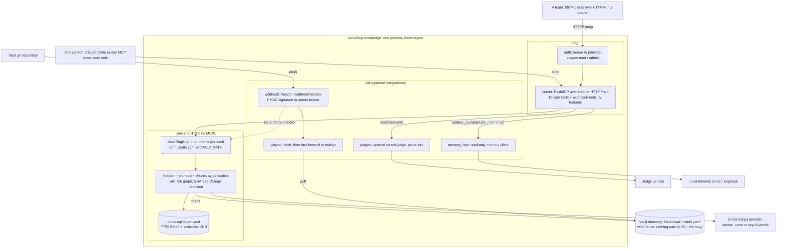

# Architecture

How one `cloudfrog-knowledge` process serves its vaults: who calls it, which layer each module belongs to, and where the index and the optional integrations sit.

## Diagram

The image is generated from [`architecture.mmd`](architecture.mmd) so that it also renders where Mermaid does not (PyPI, mirrors, offline viewers). How to regenerate it is in [CONTRIBUTING.md](../CONTRIBUTING.md#architecture-diagram).

The same diagram as Mermaid, rendered by GitHub

## How a vault becomes an index

The flow: the vault (a directory, usually a clone of its own git repository) is parsed into documents and chunks. Frontmatter becomes metadata, wiki-links become graph edges, and each chunk is written to the vault's `index.sqlite` with its FTS5 row and its embedding. Indexing is automatic: the first tool call that needs the index builds it, and later reindexes reprocess only files whose SHA-256 changed. A push to the vault's repository reaches `/webhook/reindex`, which brings the clone to the tip of the served branch and reindexes what changed.

## Components

Main components (35 flat modules in `src/knowledge`, in three layers that [`.importlinter`](../.importlinter) enforces: core, ext and http; see [CONTRIBUTING.md](../CONTRIBUTING.md#layered-architecture)):

- **`server.py`**: the FastMCP server, stdio or HTTP (`MCP_TRANSPORT`). Tools run off the event loop (the `_offloaded` decorator), so a slow search does not block the rest. It is the only module that imports extensions, the first time they are needed.
- **`auth.py`**: bearer middleware with constant-time comparison. `/health` stays open; `/webhook/reindex` validates the webhook HMAC or a manual bearer.
- **`webhook.py`**: validates the signature, updates the vault clone (`gitsync`) and triggers the reindex in the background. It also serves `/health`. The server registers `/webhook/reindex` only when the default vault declares a repository (`repo` or `VAULT_REMOTE`); `/health` is always there.
- **`extensions.py`**: the declarative registry of the extensions a vault turns on with `features` (`flows`, `governance`, `confluence`, `git-webhook`, `jira`, `memory-bridge`): the tools and routes each one adds, the module that implements it, its credential variables and the transports that load it. It names modules as text; only `server.py` imports them.
- **`flows.py`**: `get_flow` and `compare_flows` over the vault's flow documents, loaded on first use.
- **`jira_client.py`**: a read-only client for Jira Cloud's JQL search (`GET /rest/api/3/search/jql`, paginated with `nextPageToken`), with basic auth and no proxies or redirects.
- **`jira_sync.py`**: the `jira` extension: builds the JQL, turns each issue into a memory task and writes it with `memory_bridge.py`; keeps its cursor in `jira_sync.json`. Loaded the first time `sync_jira` or `jira sync` runs.
- **`indexer.py`**: frontmatter parsing, chunking by level-2 headings (`chunker.py`), embeddings, and an atomic per-file write to the vault's `index.sqlite` (`stores.py`: FTS5 and `sqlite-vec` vectors). Change detection by SHA-256.
- **`graph.py`**: the bidirectional wiki-link graph: `related`, `has_node`, `neighbors`, and BFS for `find_path` and `get_impact`.
- **`config.py`**: a compatibility facade over `settings.py`, the explicit configuration: environment variables, `.env`, each vault's `vault.yaml` and, if present, the project's `config.json` or the one `KNOWLEDGE_CONFIG_JSON` names.
