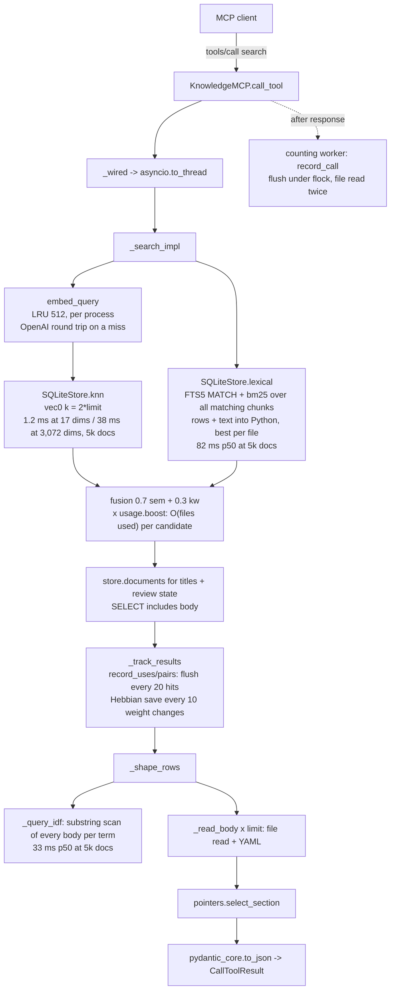

# Performance improvement plan

Status: Phases 0 and 1 delivered except 0.5 (deferred) and 1.9 (dropped); see [Status of Phases 0 and 1](#status-of-phases-0-and-1). Phases 2 and 3 are still proposals. Baseline measured on 2026-10-31 at commit `ff514e7` (`cloudfrog-knowledge` 0.9.0, contract 2.0.0); the sections after the status are the original proposal, unchanged.
Scope: the MCP server in `src/knowledge`, its CLI and the Claude Code plugin launcher. Vault content is out of scope.

## Executive summary

The server is fast on the fixture vault: `search` takes about 3 ms in process and 5 ms over stdio. It does not stay fast as a vault grows. On a synthetic 5,000-document vault (12,669 chunks), the default `search` takes **122 ms p50 and 214 ms p95** in process. Almost none of that is vector search: `sqlite-vec` KNN takes 1.2 ms there, and 38 ms at production dimensions (3,072). The time goes into five places, and none of them changes what a tool returns:

1. **Keyword path.** `SQLiteStore.lexical` pulls every matching chunk, with its text, into Python before keeping the best chunk per file (82 ms p50). A two-phase prototype gives the same answers for all 4,800 queries checked, at 31 ms instead of 73 ms. The section selector then recomputes a substring idf by scanning every document body for each query term (`KeywordIndex.idf`, 33 ms p50, about 17 ms per term). A prototype that computes the same idf from a vocabulary of whitespace runs gave identical values for all 568 terms tested, at 0.18 ms per term.
2. **Usage accounting grows without bound and runs in the request path.** `usage_stats.json` grows with every search, because each search stores its co-retrieval pairs for 5 weeks. The whole file is read twice and rewritten every 20 recorded hits, which is about every 3–4 searches. A flush costs 3.6 ms at 155 KiB, 32 ms at 1.4 MiB, 160 ms at 5.4 MiB and 666 ms at 19 MiB. It runs inside the `search` and `get_document` worker thread, which is why `get_document` has a 1 ms p50 but a 25 ms p95.
3. **Index writes.** Deleting a document's old vectors scans the whole `vec0` table with an `IN (subquery)`, even for a document that is new. Each document is also committed in its own transaction. Together these are 13.2 s of a 19.3 s instrumented full build at 5,000 documents (18.8 s uninstrumented). A prototype with deletes by id and one transaction per embedding batch builds byte-identical tables in **7.1 s (2.65×)**.
4. **Launch.** The plugin starts the server with `uvx --from git+https://…@v0.9.0`. That costs 470–750 ms of launcher time on every warm start. The same release pinned from PyPI costs 75–90 ms. `doctor --brief`, which the SessionStart hook runs on every session, imports the MCP SDK for nothing: 750–910 ms, against 140–200 ms with byte-identical output when `knowledge.server` is not imported.
5. **Incremental reindex.** A reindex with no changed file still costs 1.8 s at 5,000 documents. About 0.9 s of that is `pathlib` (`relative_to`, `rglob`), and 0.44 s is YAML-parsing unchanged files only to rebuild links.

Together, the measured category A items take the 5,000-document `search` from 122 ms to an estimated 35 ms p50. Every item in Phases 1 and 2 is category **A**: the output stays byte-identical, the goldens stay unchanged, and there is no contract bump. Each one is checked by the frozen goldens plus a differential test against the current implementation. Three levers can give large further gains: OpenAI `dimensions`, vector quantization, and narrower prefix matching. All three change scores, so they are category **B** and grouped in Phase 3 behind the retrieval evaluation harness.

Proposed SLOs for a 5,000-document vault on the reference runner (in-process tool time, provider network excluded): `search` **p50 ≤ 35 ms** after Phases 1–2, which the measured prototypes support; **p95 ≤ 60 ms** on a calibrated query set, which on today's unselective synthetic queries needs Phase 3.3, because FTS5 `bm25()` alone has a 95 ms p95 there; `get_document` **p99 ≤ 5 ms**; `context_pack` **p95 ≤ 80 ms**; `search_deep` **p95 ≤ 150 ms**; launcher overhead **≤ 150 ms**; `doctor --brief` **≤ 300 ms**; no-op reindex **≤ 600 ms**; usage flush **≤ 5 ms and never on a request thread**.

## Status of Phases 0 and 1

Every delivered item is category **A**: the frozen goldens (`tests/golden/v2.0.0/`, all six sessions) and `docs/tools/inventory.md` are unchanged, and the contract stays at 2.0.0. Commits are those of the `perf/phase-0-1` branch. Counts are exact (the work-budget tests); times come from the `benchmarks/` harness, base `a89cd5e` against the branch tip on the same 4 vCPU VM and the same interpreter (CPython 3.12.3, SQLite 3.45.1, `sqlite-vec` 0.1.9), bag-of-words, generated vaults of 500 and 5,000 documents (seed 7; 1,370 and 14,364 chunks), 200 calls per scenario. Wall clock on this VM is good to about 10–15 %. The full before/after tables, with the trade-offs, are in [`results-phase-0-1.md`](results-phase-0-1.md).

| # | Status | Commits | Measured result |
|---|---|---|---|
| 0.1 | Done | `ee44a08`, `e1dad64` | `python -m benchmarks run\|compare\|info`; pyperf only through `uv run --with pyperf==2.10.0`, never in `uv.lock`. No `make bench` target: `uv run python -m benchmarks` is the entry point. How to run it: [`benchmarks.md`](benchmarks.md). |
| 0.2 | Done | `4eeedc2`, `f163991`, `aa72ce8`, `75205a7` | A read-only observer hook on `SQLiteStore` (no patching), `tests/perf_counters.py`, the generator `tests/synthetic_vault.py` and `tests/test_perf_budgets.py`, lowered after Phase 1 to the counts below; each stream adds `tests/test_perf_budget_{store,request,cli}.py`. |
| 0.3 | Done | `29acb42` | `tool_latency` section in `usage_stats.json` (fixed buckets 1 ms to 5 s, 120 days, no arguments); `doctor` reports `tool_calls.latency_ms` (calls, p50, p95 per tool) once a call was timed. |
| 0.4 | Done | `9d028ea` | `doctor --shape`: aggregate numbers only, index opened immutable, a sentinel test proves no path, title, tag, heading or query term leaves. `Shape.from_export` consumes it. |
| 0.5 | Deferred | — | No workflow added; to be decided once the harness has a history. |
| 1.1 | Done | `dae2f2b` | `--from cloudfrog-knowledge==<version>`. Warm `uvx … python -c pass`: 536 → 92 ms (median of 10); cold 10.0 → 3.7 s (one sample). Release order: the marketplace PR waits for `publish.yml` to publish the version to PyPI ([`ci-ring1.md`](../runbooks/ci-ring1.md), section 6). Takes effect with the first plugin release after 0.9.0. |
| 1.2 | Done | `32bae86` | `doctor --brief` 812 → 185 ms, `import knowledge.cli` 594 → 116 ms (harness p50); `--version` imports 15 `knowledge` modules instead of 27, none of `server`, `mcp`, `starlette`, `uvicorn`. |
| 1.3 | Done | `15b6d18`, `7e5212c`, `e618c4b` | Full build at 5,000 docs 18.6 → 6.6 s (2.8×), at 500 docs 981 → 645 ms; commits of a first build of 500 docs 500 → 41, subselect vec0 deletes 499 → 0; the index is identical row by row. A store error inside a batch now rolls back the whole batch (the run fails as before and reports no file; the next run writes it). |
| 1.4 | Done | `4ca5dd6`, `1c977a4` | `_query_idf` at 5,000 docs about 35 → 0.3 ms cold and about 0 warm; memory held between reindexes 24.9 → 6.9 MB; values equal with `==` on 5,000+ terms per corpus. Cost: the vocabulary is built by the first search after each reindex or start (one-time, about 0.06 → 0.75 s at 5,000 docs; first `search` 447 → 831 ms there). |
| 1.5 | Done | `e09f38f`, `a9d4d3e`, `d18bb34` | One read of `usage_stats.json` per write (2 → 1); the registry's trackers write on a `usage-flush` thread every 2 s, never on a request thread (155 → 0 request-thread writes over 700 tool calls); `get_document` p95 21.5 → 1.1 ms (500 docs), 3.1 → 1.6 ms (5,000). A hard crash may lose about 2 s of counts. |
| 1.6 | Done | `10ee3fc`, `8fb3a57` | Learned weights saved on a single `graph-save` worker, coalesced per runtime; `link_graph.json` compact (153 → 121 KB on 500 docs). |
| 1.7 | Done | `72caeed` (store), `67b5c49`, `7a2f00b` (call sites) | `search`, `search_deep`, `context_pack` (through `search`), `search_by_metadata` and `get_stale_docs` read no `docs.body` (rows carrying `body` in one `search_deep` 63 → 0, in one `search_by_metadata(type=runbook)` 10 → 0). |
| 1.8 | Done | `0f861c7` | `PRAGMA mmap_size` 256 MiB on every connection. Interleaved A/B (40 paired repetitions): lexical −18 to −22 % on the 85 MB index, KNN −20 % on a 438 MB 3,072-dimension index. Cost, documented at `MMAP_SIZE`: SIGBUS instead of `sqlite3.Error` on an I/O error of a mapped page, and mapped pages count in RSS (file-backed, reclaimable): RSS after the tool mix at 5,000 docs 160 → 437 MiB, all of the increase `RssFile` (anonymous memory fell). |
| 1.9 | Dropped | — | 15–18 ms per start did not justify changing the import-time registration of `server.mcp`. |

Harness, base against tip (p50 / p95 in ms):

| Scenario | 500 docs | 5,000 docs |
|---|---|---|
| `search` hybrid, selective (2 %) | 8.6 / 12.1 → 4.9 / 6.2 | 51.4 / 64.9 → 5.7 / 8.1 |
| `search` hybrid, Zipf | 14.9 / 32.9 → 11.0 / 15.7 | 108 / 145 → 79 / 133 |
| `context_pack`, selective | 13.1 / 31.6 → 7.5 / 10.7 | 55.9 / 70.6 → 8.9 / 16.8 |
| `search_deep`, Zipf | 55.1 / 81.7 → 39.7 / 53.3 | 752 / 867 → 791 / 957 (within noise; the hop pass is 2.3) |
| `get_document` by path | 0.67 / 21.5 → 0.78 / 1.10 | 0.82 / 3.12 → 1.06 / 1.58 |
| index full build | 981 → 645 | 18,611 → 6,596 |
| no-op reindex | 134 → 125 | 1,436 → 1,524 (unchanged; 2.2) |
| stdio `search` round trip (500 docs) | 14.0 / 42.0 → 7.7 / 8.7 | |

Against the proposed SLOs at 5,000 documents, after Phase 1: selective `search` p50 5.7 ms and `context_pack` p95 16.8 ms are inside them; `get_document` p99 is under 5 ms; `doctor --brief` (185 ms) and the warm launcher (92 ms) are inside them; the full build (6.6 s) is under 8 s. Still outside: `search` on unselective Zipf queries (2.1, 3.3), `search_deep` (2.3), the no-op reindex (2.2) and spawn to `initialize` (700 ms, the SDK import).

## How to read the numbers

- **Machine.** 4 vCPU Intel Xeon @ 2.10 GHz, 16 GiB, Linux 6.18. The `.venv` interpreter is the system CPython 3.12.3 (not the uv-managed build the goldens are recorded with). SQLite 3.45.1, `sqlite-vec` v0.1.9 loaded (`vector_backend: sqlite-vec`), uv 0.11.32. It is a shared cloud VM: expect ±10–15 % run-to-run noise on wall-clock numbers. Only differences much larger than that are used as evidence below.
- **Data.** No real vault was used. `tests/fixtures/vault/` (14 documents) was copied to a scratch directory. Two synthetic vaults came from a deterministic generator:
  - `syn500`: 500 documents, 2.5 MB, 1,402 chunks.
  - `syn5000`: 5,000 documents, 22.9 MB, 12,669 chunks.

  Both have frontmatter, 3–9 `## ` sections, log-normal body sizes (median about 3 KB, tail to 40 KB) and wikilinks. Embeddings come from `bag-of-words` (17 dimensions, offline). Production-dimension KNN was measured separately with random unit vectors at 1,024 and 3,072 dimensions.
- **Known bias of the synthetic data.** The generated queries are built from Zipf-distributed words, and every token of four or more characters is a prefix match. As a result, a query matches a median 10,761 of the 12,669 chunks (85 %; minimum 139). Real queries are probably more selective, so the keyword-path numbers at 5,000 documents are an upper bound. The fix stands either way, because its cost scales with the number of matching chunks. Phase 0 calibrates the generator against real distributions (see [Methodology](#methodology-to-adopt)).
- **Measurement rules.** Latencies are wall clock (`time.perf_counter`) over at least 200 calls (300 unless stated), after 10 warm-up calls per tool. `usage_stats.json` was deleted before each run. cProfile was used only to find call counts and shares: it inflates totals (the 5,000-document build measures 22.9 s profiled against 18.8 s unprofiled).
- **Raw data.** Raw measurements were collected ad hoc and are not committed; the commands and figures quoted here are the exact ones used. Phase 0 adds a reproducible harness.

## Current architecture of the hot paths

| Path | Where | What it does today |
|---|---|---|
| Process start | `server.py` import, `serve()` | Imports `mcp.server.fastmcp` (which pulls `mcp.types`, `httpx`, `jsonschema`, `starlette`). Registers 10 tools at import with `structured=True`, and registers them again in `serve()` when structured output is off, which is the default (`server.py:2848-2851`). Opens the default vault. |
| Launch (plugin) | `plugin/claude-code/.mcp.json`, `scripts/session-start.sh` | `uvx --managed-python --python 3.12 --from git+https://github.com/cloudfroghq/knowledge.git@v0.9.0 cloudfrog-knowledge serve --transport stdio`. The hook runs `doctor --brief` with the same spec. |
| First tool call | `_ensure_indexed` (`server.py:303`) | Loads `link_graph.json`, or builds the whole index when the store is empty. |
| Index build | `VaultIndexer._index_vault` (`indexer.py:451`) | `rglob` walk, sha256 per file, YAML frontmatter, chunking (2,500 chars, 10 % overlap), embedding in batches of 32 (`EMBED_BATCH`, sequential), then `SQLiteStore.replace_file` once per document, each in its own `BEGIN IMMEDIATE … COMMIT`. |
| `search` (hybrid) | `_search_impl` (`server.py:1299`) | Query embedding (LRU of 512 per process), KNN `k = 2·limit` through `vec0`, FTS5 BM25 over every matching chunk, best chunk per file, fusion `0.7·sem + 0.3·kw` times the usage boost, then `_shape_rows`. Tracking writes usage counters and Hebbian weights. |
| `_shape_rows` | `server.py:977` | For the default `chunk_id`/`section`: computes a substring idf of every query term over all bodies, then reads each result file from disk and parses its frontmatter. |
| `search_deep` | `_search_deep_impl` (`server.py:1760`) | One hybrid search, a breadth-first walk of up to 3 hops, then one KNN restricted to the hop files with `k = 3·hops`. When that `k` exceeds 4,096 it falls back to stdlib cosine over every chunk of those files. |
| `context_pack` | `server.py:2609` | Hybrid search (8 rows), idf, one disk read per row, greedy fill with a JSON-size token estimate. |
| Per `tools/call` | `KnowledgeMCP.call_tool` (`server.py:87`) | Queues a count on a single counting worker. Every 20 hits that worker, or the request thread, flushes `usage_stats.json` under a cross-process `flock`. |

## Measured baseline

### Process start and launch

| Measurement | Result |
|---|---|
| `import knowledge.server` (wall, 5 runs) | 568–659 ms. Of that: `mcp.types` 405–488 ms (SDK), `pydantic` 54–68 ms, `knowledge.server` body and own dependencies 62–70 ms. |
| Re-registration of the tools in `serve()` | 15–18 ms |
| `knowledge.cli` on top of `knowledge.server` | 11–18 ms |
| Spawn to `initialize` response, `.venv/bin/python -m knowledge.server` (7 runs, sorted) | 559, 600, 609, 642, 682, 685, 737 ms |
| Same through `cloudfrog-knowledge serve` / `uv run --no-sync` / `uv run` | 597–771 / 645–691 / 628–692 ms |
| `tools/list` after `initialize` | 3.1–3.2 ms |
| First `search` after start, with an existing index (fixture / syn5000) | 8 ms / 153 ms |
| uvx launcher alone (`python -c pass`), warm cache, 5 runs: `git+https://…@v0.9.0` | 469, 511, 518, 529, 754 ms |
| uvx launcher alone, warm cache, 5 runs: `cloudfrog-knowledge==0.9.0` from PyPI | 74, 79, 84, 90, 91 ms |
| uvx first run on an empty cache (git / PyPI) | 5.4 s / 3.5 s |
| `cloudfrog-knowledge --version` through uvx (PyPI, warm) | 816–934 ms (imports the whole server) |
| `cloudfrog-knowledge doctor --brief` (5 runs) | 749–912 ms |
| Same with `knowledge.server` replaced by a stub (prototype of a lazy import) | 141–198 ms; full `doctor` JSON byte-identical |

The uvx numbers went through this environment's HTTPS proxy, so the absolute git-fetch cost will differ on a developer laptop. The order-of-magnitude gap will not, because the PyPI path makes no network request when the pinned wheel is already cached.

### Index build (bag-of-words, no network)

| Vault | Docs / chunks | Full build | No-op reindex | 1 file changed | `index.sqlite` | `link_graph.json` |
|---|---|---|---|---|---|---|
| fixture | 14 / 14 | 0.026 s | 0.007 s | 0.008 s | 72 KiB | 1.6 KiB |
| syn500 | 500 / 1,402 | 1.1–1.2 s | 0.20 s | 0.15 s | 8.6 MiB | 457 KiB |
| syn5000 | 5,000 / 12,669 | 18.8–19.3 s | 1.73–1.89 s | 1.66 s | 77 MiB | 4.0 MiB |

Statement time during the 5,000-document build (per-statement timer):

| Statement | Calls | Time |
|---|---|---|
| `DELETE FROM chunks_vec WHERE id IN (SELECT id FROM chunks WHERE file_path IN (?))` | 4,999 | **8.24 s** |
| `COMMIT` (one per document) | 5,001 | **4.96 s** |
| `INSERT INTO chunks …` (fires the FTS5 trigger) | 12,669 | 1.61 s |
| `INSERT INTO chunks_vec …` (executemany) | 5,000 | 0.57 s |
| everything else | — | < 0.5 s |

Parts of a no-op reindex at 5,000 documents (each timed alone, best of 3):

| Step | Time | Cheaper equivalent measured |
|---|---|---|
| `DirectoryVaultSource.markdown_files()` (`rglob`, `sort`, `relative_to` per path) | 198 ms | `os.walk` plus string filter: 5.6 ms |
| 15,000 × `indexer._rel` (`Path.relative_to`) | 509 ms | string slice: 2.6 ms |
| 5,000 × sha256 of the file | 69 ms | — |
| 5,000 × `frontmatter.load` of unchanged files, for their links | 440 ms | the same body is already in `docs.body` |
| `LinkIndex.build` | 204 ms | mostly `relative_to` |
| Extract and resolve wikilinks | 434 ms | — |
| `LinkGraph.save` (JSON `indent=2`, 4 MiB) | 65 ms | — |

### Query latency in process (ms; 300 calls, p50 / p95 / p99)

| Tool | fixture | syn500 | syn5000 |
|---|---|---|---|
| `search` (default, hybrid) | 2.9 / 5.2 / 6.7 | 17.8 / 29.8 / 34.3 | **122.1 / 213.6 / 244.1** |
| `search` keyword | 1.9 / 4.6 / 5.4 | 20.0 / 32.0 / 52.8 | 124.8 / 224.2 / 272.6 |
| `search` semantic | 2.8 / 5.0 / 6.1 | 8.7 / 22.5 / 27.5 | 44.9 / 79.9 / 94.0 |
| `search` limit=20, snippet | 6.9 / 10.9 / 13.5 | 59.3 / 85.7 / 95.4 | 169.0 / 278.7 / 311.3 |
| `search_deep` | 4.4 / 7.0 / 9.8 | 66.6 / 96.1 / 131.5 | **258.4 / 387.3 / 454.7** |
| `context_pack` | 4.6 / 8.4 / 10.5 | 30.5 / 63.2 / 76.7 | 147.2 / 266.5 / 307.0 |
| `get_document(file_path)` | 0.9 / 2.4 / 2.9 | 1.0 / 24.2 / 30.7 | 1.1 / **25.4** / 33.7 |
| `get_document(chunk_id)` | 0.8 / 3.3 / 3.9 | — | 1.1 / 30.5 / 41.3 |
| `get_related` | 0.19 / 0.28 / 0.61 | 0.26 / 0.65 / 1.4 | 0.26 / 0.42 / 0.64 |
| `get_impact` | 0.18 / 0.33 / 0.48 | 0.48 / 1.0 / 2.9 | 0.53 / 0.78 / 1.0 |
| `find_path` | 0.16 / 0.37 / 0.65 | 1.0 / 2.1 / 2.9 | 3.8 / 25.2 / 29.6 |
| `search_by_metadata(type=runbook)` | 0.20 / 0.26 / 0.29 | 2.0 / 2.9 / 3.2 | 22.1 / 40.3 / 84.9 |
| `list_vaults` | 0.13 / 0.23 / 0.34 | 0.20 / 0.38 / 0.60 | 0.18 / 0.29 / 0.37 |

Pieces of one hybrid search at 5,000 documents (p50 / p95 / p99):

| Piece | ms |
|---|---|
| `embed_query` (cache hit) | 0.001 |
| `store.knn(k=10)`, 17 dims | 1.21 / 1.37 / 1.43 |
| `store.lexical(k=10)` | **82.3 / 186.2 / 221.7** |
| `_query_idf` | **33.1 / 64.4 / 74.6** |
| `_read_body` (one file) | 0.24 / 0.36 / 0.46 |
| `usage.record_call` (amortized; a flush every 20) | 0.004 / 1.19 / **27.3** |
| `usage.flush` (1 MiB file) | 29.9 / 39.0 / 52.6 |
| `usage.boost` × 10 candidates, 5,000 files with usage | 2.4 (500 files: 0.24) |

### End to end over stdio (300 round trips, ms)

| Vault | `list_vaults` p50 / p95 / p99 | `search` p50 / p95 / p99 | Server RSS after 600 calls |
|---|---|---|---|
| fixture | 1.87 / 3.05 / 4.81 | 4.76 / 6.68 / 8.46 | 63 MB |
| syn5000 | 1.65 / 2.61 / 3.91 | 125.9 / 216.9 / 280.5 | 132 MB |

The transport, JSON-RPC, pydantic validation and the counting hand-off add about 1.5 ms per call (stdio `list_vaults` against in-process `list_vaults`). That is not where the time goes. A search response is about 1 KB, so serialization is not a cost worth optimizing.

### Vector search at production dimensions (`SQLiteStore.knn`, k=10, default search filter; ms p50 / p95 / p99)

| Chunks × dims | `sqlite-vec` (vec0, float32) | stdlib fallback | Same top-10 |
|---|---|---|---|
| 1,500 × 3,072 | 17.4 / 20.5 / 31.3 | 187 / 272 / 286 | 100 % |
| 5,000 × 3,072 | 37.7 / 44.8 / 47.2 | 625 / 747 / 818 | 100 % |
| 20,000 × 3,072 | 130 / 152 / 163 | 2,477 / 2,761 / 2,847 (40 queries) | 100 % |
| 5,000 × 1,024 | 13.3 / 14.4 / 15.4 | 226 / 301 / 323 | 100 % |

At 1,500 × 3,072 the fallback is 10.7× slower here. `CLAUDE.md` quotes about 110 ms against about 10 ms on another machine.

Quantization candidates were measured with raw vec0 SQL, without rescoring, and are not used by the store:

| Encoding | 1,500 × 3,072 | 5,000 × 3,072 |
|---|---|---|
| float32 vec0 | 13.1 ms | 34.2 ms |
| int8 (`vec_quantize_int8`) | 7.9 ms | 28.8 ms |
| bit (`vec_quantize_binary`) | 0.44 ms | 1.0 ms |

Effect of connection PRAGMAs (one run each, warm OS cache):

| Connection setting | Lexical query, syn5000 (p50 / p95) | KNN 5,000 × 3,072 (p50 / p95) |
|---|---|---|
| As shipped (`journal_mode=WAL`, `synchronous=NORMAL`) | 56.2 / 159.6 ms | 32.1 / 35.2 ms |
| `cache_size=-65536` | 52.6 / 146.2 ms | 33.6 / 38.1 ms |
| `mmap_size=1 GiB` | 43.0 / 131.3 ms | 25.7 / 31.2 ms |
| both, plus `temp_store=MEMORY` | 46.4 / 138.0 ms | 25.1 / 26.3 ms |

### Usage file growth (`UsageTracker.flush`, 5 results per search, random pairs)

| Searches recorded | `usage_stats.json` | Co-retrieval pairs | Flush p50 / max | One read + `json.loads` |
|---|---|---|---|---|
| 100 | 155 KiB | 1,000 | 3.6 / 6.1 ms | 1.2 ms |
| 1,000 | 1.4 MiB | 9,993 | 31.7 / 47.0 ms | 8.4 ms |
| 5,000 | 5.4 MiB | 49,897 | 160 / 217 ms | 50 ms |
| 20,000 | 19.2 MiB | 198,348 | 666 / 785 ms | 237 ms |

Random pairs are a worst case: real co-retrieval repeats pairs, so the pair count grows more slowly. The other terms are real: the file is read and parsed twice per flush (`_merge_disk_spend_locked` and `_disk_call_days`), `query_opens` keeps up to 2,000 events, and pairs are pruned only when their ISO week leaves the 5-week window.

### Memory (RSS, syn5000)

| Point in the process | RSS |
|---|---|
| Bare interpreter | 21 MB |
| After importing `knowledge.server` | 61 MB |
| After opening the vault and loading the graph | 78 MB |
| After the keyword index is built (lowercased copy of every body) | 122 MB |
| After 200 searches | 162 MB |
| After the full tool mix above | 265 MB (`search_deep` alone adds about 70 MB) |
| Peak of the whole benchmark process | 395 MB |

### Not measured here (estimates, labeled as such)

- **OpenAI embeddings latency.** No key, no network. Estimate from the code: a query that misses the per-process LRU costs one `embeddings.create` round trip, typically 100–400 ms (estimate). A full build of 12,669 chunks makes 396 sequential requests of 32 inputs (`indexer.py:518-524`). At 0.3–0.6 s each that is 2–4 minutes of provider time (estimate) on top of the 7–19 s measured locally.
- **Rerank judge (`jev`/`kev`).** Its network time was not measured. From the code: a judged search runs the hybrid search twice whenever the judge is skipped after the pool is built (gap, breaker, budget: `server.py:1598-1630`). With a daily cap it re-reads the whole `usage_stats.json` before each judge call (`usage.py:551-569`). Each worker thread opens its own TLS connection (`judges.py`, `threading.local`), so up to `min(32, cpu+4)` handshakes happen per process. The verdict cache lives in memory, so every new stdio process (every Claude Code session) starts cold.
- **HTTP transport overhead.** `BearerAuthMiddleware` is a Starlette `BaseHTTPMiddleware`, which wraps every request in an extra task and stream. Its cost was not measured. Phase 0 measures it before anything is changed.

## Bottlenecks found (ranked by user-visible impact)

1. **Keyword retrieval materializes every match.** `stores.py:903-915` selects `file_path, ord, text, overlap, bm25()` for every chunk the FTS5 query matches, joined to `chunks` and `docs`. It builds a `ChunkHit` per row (1.79 M objects over 200 searches) and reduces them in `_best_per_file` (`stores.py:145-152`).
   - At 5,000 documents this is 82 ms p50 and 186 ms p95 per search. The profile: `fetchall` takes 51 ms per query, row objects 13 ms and `_best_per_file` 26 ms.
   - The SQL alone shows where SQLite spends it: FTS5 plus `bm25()` costs 12.7 ms p50, and the joins to `chunks` and `docs` with the memory filter bring it to 42 ms.
   - Prefix expansion of tokens of four or more characters dominates the tail: a count of matches takes 1.15 / 36 ms (p50 / p95) with prefixes and 0.52 / 1.08 ms without.
   - Each search pays this twice when `mode=hybrid` is reranked and skipped, and `search_deep` and `context_pack` pay it through `_search_impl`.
2. **Section-pointer idf rescans the corpus.** `_shape_rows` (`server.py:997-1005`) always needs `_query_idf` for the default fields (`chunk_id`, `section`). `KeywordIndex.idf` (`indexer.py:83-87`) runs `needle in body` over every lowercased body for every term, about 17 ms per term at 22 MB of text. `context_pack` (`server.py:2480`) and rerank (`server.py:1614`) compute it again. The lowercased bodies (`indexer.py:291-297`) also add 44 MB of RSS at 5,000 documents, and nothing but `idf` reads them in the server.
3. **Usage persistence is O(history) and runs on request threads.**
   - `record_uses` and `record_pairs` (`usage.py:403-427`) flush inline every 20 hits. Each flush (`usage.py:712-743`) reads and parses the file twice (`usage.py:562-577`) and rewrites all of it.
   - The cost grows linearly with recorded history: 32 ms at 1.4 MiB, 160 ms at 5.4 MiB, 666 ms at 19 MiB. The tracker's lock is held during that I/O, so concurrent searches over HTTP queue behind it.
   - This is the whole 25 ms p95 of `get_document`, which records two hits per read.
   - `boost()` (`usage.py:600-608`) recomputes the maximum over every used file for every candidate: 2.4 ms per search with 5,000 used files.
4. **Index writes are quadratic and commit per document.** `_delete` (`stores.py:638-650`) issues a `vec0` `DELETE … WHERE id IN (SELECT …)`, which `sqlite-vec` resolves by scanning its table (1.65 ms per call on average while the table grows to 12,669 rows, so the cost grows with the table), even when the document has no chunks yet. `replace_file` (`stores.py:652-699`) opens and commits a transaction per document (5,001 commits, 4.96 s). Together: 70 % of the build.
5. **The plugin launcher re-resolves a git tag on every start.** `plugin/claude-code/.mcp.json` uses `--from git+https://…@v<version>`. That costs 470–750 ms per warm launch and 5.4 s cold here. The server start and the SessionStart hook each pay it, and the hook pays the SDK import too (item 6).
6. **The CLI imports the MCP SDK for subcommands that never serve.** `cli.py:31` imports `knowledge.server` at module load. `doctor`, `init`, `vault-lint` and `--version` therefore pay the 400–490 ms `mcp.types` import. Only `serve` and the three extension subcommands use `server` (`cli.py:354, 1260, 1317, 1372, 1391`).
7. **The incremental reindex re-does work proportional to the vault.** Python 3.12 `pathlib` costs about 34 µs per `relative_to` (15,000 calls in `_rel`, plus the walk and `LinkIndex.build`), about 0.9 s at 5,000 documents. Every unchanged file is also YAML-parsed only to recover its body for link extraction (`indexer.py:476-483`, 440 ms), although the store already holds that body (`docs.body`). The webhook reindexes on every push, so this is paid per push.
8. **`search_deep` falls off the vec0 path on dense graphs.** The hop KNN asks for `k = 3·len(hop_files)` (`server.py:1870`). Above 4,096, `_knn_vec` returns `None` (`stores.py:864-865`) and the stdlib fallback ranks every chunk of the hop files (87 of 100 calls on syn5000). `_documents` then loads full bodies only to read titles (`server.py:1875`, `stores.py:752-777`; `_DOC_COLUMNS` includes `body`). The debounced Hebbian save rewrites the 4 MiB pretty-printed graph on the request thread (`server.py:1047-1050`, `graph.py:494`). The synthetic graph is denser than a typical curated vault, so this is a tail rather than a median problem; the code path is real either way.
9. **Smaller items, measured.**
   - `search_by_metadata` selects `body` for every matching document (7.2 ms against 2.1 ms without it, for `type=runbook` at 5,000 documents).
   - No `mmap_size` on store connections (`stores.py:501-504`): lexical −23 % and KNN −20 % with `mmap_size=1 GiB` in one run.
   - Tools are registered twice when structured output is off (15–18 ms per start).

## Methodology to adopt

### What we measure, and how

- **RED per tool, from the server itself.** The server already counts rate and errors per tool, client and principal in `tool_calls` (`usage.py`). Add a duration histogram with fixed buckets, the same pattern `rerank.latency_ms` already uses, so `doctor` can report p50/p95 per tool from real traffic without any external agent. Buckets, not raw samples: the file stays bounded and no argument is ever stored ([RED method](https://grafana.com/blog/2018/08/02/the-red-method-how-to-instrument-your-services/)).
- **USE for the resources a call contends for** ([USE method](https://www.brendangregg.com/usemethod.html)):
  - CPU: worker threads under the GIL. At 120 ms of CPU per search, one process tops out near 8 searches/s over HTTP (estimate from the in-process time).
  - SQLite: lock waits on `busy_timeout`; the single writer connection.
  - Sidecar file I/O: `usage_stats.json`, `link_graph.json`, and the `flock`.
  - Memory: RSS per vault.

  Each resource gets one counter or gauge that Phase 0 exposes in `doctor`.
- **Latency is reported as percentiles, never means.** Use p50, p95 and p99 over at least 200 calls after a warm-up, with the call mix fixed per tool ([Google SRE, SLOs](https://sre.google/sre-book/service-level-objectives/)). Cold paths are reported separately: first call, cache miss, first `search` after start.
- **Profiling workflow.**
  1. Start with a sampling profiler to attribute wall time without distorting it: [py-spy](https://github.com/benfred/py-spy) `record --native` on a running stdio or HTTP server, or [pyinstrument](https://github.com/joerick/pyinstrument) in process. Both run through `uvx` or `uv run --with`, so nothing enters `uv.lock`.
  2. Use deterministic `cProfile` only for call counts. It inflated the build by 22 % here.
  3. Use `python -X importtime` for start-up.
  4. Use `tracemalloc` or [memray](https://github.com/bloomberg/memray) for RSS questions.
  5. For SQL, time per statement shape: a `sqlite3.Connection` subclass, as used for this baseline, or `set_trace_callback` for counts.
- **Data.** Never a real vault: the fixture plus the deterministic generator in the harness. To make synthetic numbers representative, add a read-only `doctor --shape` style export, which the owner runs on their own machine. It would report only distributions, never content: document count, body-size percentiles, chunks per document, links per document, and the document frequency of query terms seen in `query_opens`. The generator is then calibrated to those numbers. This fixes the over-matching bias noted above without a real vault entering the repository or CI.

### Proposed budgets and SLOs

Reference conditions: Linux, 4 vCPU, `sqlite-vec` loaded, 5,000-document synthetic vault calibrated as above. Times are in-process tool time with embedding and judge network excluded. Embedding and judge time get their own budget: query embedding is free on a cache hit, and on a miss it is bounded by the provider. Rerank stays bounded by `rerank.timeout_ms`, as it already is.

| Path | Today (syn5000) | SLO | Rationale |
|---|---|---|---|
| `search` (default) | 122 / 214 / 244 ms | p50 ≤ 35 ms; p95 ≤ 60 ms and p99 ≤ 100 ms on the calibrated query set | Projection from the measured pieces: lexical 82 → about 31 ms (2.1, plus about −20 % with 1.8), idf 33 → < 1 ms (1.4), boost 2.4 → 0 (1.5), so about 35 ms p50. On the current synthetic queries the p95 floor is FTS5 `bm25()` itself (95 ms), so A-only changes reach about 140 ms p95; the 60 ms p95 needs selective real queries or Phase 3.3. |
| `get_document` | 1.1 / 25.4 / 33.7 ms | p99 ≤ 5 ms | The tail is the inline flush. |
| `context_pack` | 147 / 267 / 307 ms | p50 ≤ 45 ms; p95 ≤ 80 ms on the calibrated set | Same pieces as `search`. |
| `search_deep` | 258 / 387 / 455 ms | p50 ≤ 80 ms; p95 ≤ 150 ms on the calibrated set | Shares `search`, plus the hop pass (2.3). |
| `search` at 500 documents | 17.8 / 29.8 / 34.3 ms | p50 ≤ 8 ms, p95 ≤ 20 ms | Lexical at 500 documents 6.3 → 2.8 ms p50 (2.1); idf 3.4 → < 0.1 ms (1.4). |
| Spawn to `initialize` | 559–737 ms | ≤ 650 ms p95 | Floor set by the SDK import. |
| Launcher overhead (uvx) | 469–754 ms | ≤ 150 ms | PyPI pin. |
| `doctor --brief` | 749–912 ms | ≤ 300 ms | |
| Full build, bag-of-words | 18.8 s | ≤ 8 s | |
| No-op reindex | 1.8 s | ≤ 600 ms | |
| Usage flush | 3.6–666 ms, on request threads | ≤ 5 ms, never on a request thread | |
| RSS, steady | 162–265 MB | ≤ 250 MB after the tool mix | |

The SLOs are targets for the harness, not alerts: no deployment is paged on them. Each one is re-baselined when the generator is calibrated.

### Benchmark harness design

- **Location.** A `benchmarks/` directory at the repo root, outside `src/` (not packaged, not imported by tests), containing:
  - `gen_vault.py`: deterministic generator; seed and size are arguments.
  - `bench_tools.py`: in-process, through the same `asyncio.to_thread` wrappers MCP dispatch awaits.
  - `bench_stdio.py`: spawns the real server and speaks JSON-RPC.
  - `bench_index.py`: full, no-op and one-changed reindex.
  - `bench_knn.py`: production dimensions on random unit vectors.

  Results are written as JSON with machine metadata: `nproc`, Python build, SQLite version, `vector_backend`, commit.
- **Statistics.** Use [pyperf](https://pyperf.readthedocs.io/) as a `bench` dependency group, not `dev`, so the test lock is unaffected; it can also run with `uv run --with pyperf`. It gives calibrated loops, warm-ups, worker processes and `compare_to` with a significance test. It is pure Python and small; [pytest-benchmark](https://pytest-benchmark.readthedocs.io/) and [asv](https://asv.readthedocs.io/) were considered (see [Rejected](#things-considered-and-rejected)). Percentile tables like the ones above come from the harness's own sampling mode, because pyperf reports means and standard deviations.
- **Correctness gate for every category A change.** Run the frozen goldens of `tests/golden/v2.0.0/` (unchanged by definition), plus a differential test in `tests/` that runs the old and new implementation side by side on generated vaults and compares every field. That is exactly how the prototypes below were validated: for example, 1,200 lexical answers compared field by field, and every table of a rebuilt index compared row by row. The reference implementation stays in the test as a frozen copy, as `tests/test_chunker.py` already does for the chunker.

### Gating regressions in CI without flakiness

Shared GitHub runners are noisy (±10–20 % wall clock), and the Actions policy admits only GitHub-owned actions pinned by SHA (`CLAUDE.md`). Three layers follow from that:

1. **Deterministic work budgets, blocking, in ring1's existing `pytest` job.**
   - A `tests/test_perf_budgets.py` counts work instead of timing it. Examples:
     - SQL rows a `search` fetches from SQLite (via a counting connection factory).
     - Files a `search` reads.
     - `json.loads` calls per usage flush (must be 1).
     - Transactions per indexed batch.
     - No `mcp` in `sys.modules` after `cli doctor`.
     - `usage.flush` never called on a request thread.
   - These numbers are exact, so they never flake. They catch the regressions found here: a query that starts fetching all rows again, or a second parse.
2. **Relative wall-clock comparison, advisory first.**
   - A `workflow_dispatch` and nightly job runs `benchmarks/` with pyperf on base and head, interleaved, on the same runner.
   - It publishes `pyperf compare_to` in the job summary.
   - It fails only when a benchmark is slower by more than 25 % with significance in two consecutive runs.
   - It stays advisory, outside the five required checks of `protect-main`, until four weeks of history show a false-positive rate near zero. Promoting it is then a ruleset change.
3. **Optional instruction counts.**
   - If wall clock stays too noisy, `valgrind --tool=cachegrind` from the runner's `apt` (no third-party action) gives instruction counts with very low variance, the same principle as [CodSpeed](https://codspeed.io/)'s simulation mode.
   - Only for small, CPU-bound benchmarks: the chunker, idf, best-per-file and usage merge.

## Prioritized roadmap

Contract impact legend: **A** means output byte-identical (pure speed; goldens unchanged, no version bump). **B** means scores, order, membership or shape change: contract bump, new `tests/golden/v<next>/`, `docs/contract/CHANGELOG.md`, and `docs/tools/inventory.md` regenerated with `uv run python scripts/tool_inventory.py`.

### Phase 0: instrumentation and harness

| # | Item | Expected gain | Effort | Risk | Contract | Files | Verify |
|---|---|---|---|---|---|---|---|
| 0.1 | `benchmarks/` harness: generator, in-process, stdio, index and KNN benchmarks as described above; `make bench` | Enables every claim below to be re-measured; no runtime gain | M | Low | A (no `src/` change) | `benchmarks/*`, `Makefile`, `pyproject.toml` (`bench` group), `docs/performance/` | Reproduces the baseline tables within noise on the reference runner |
| 0.2 | Deterministic work-budget tests (list above), with today's values first, then tightened by each fix | Prevents regressions with zero flake | S | Low | A | `tests/test_perf_budgets.py` | Green on ring1; each later fix lowers a budget |
| 0.3 | Per-tool duration histogram in `tool_calls` (fixed buckets) and p50/p95 per tool in `doctor` | Real-traffic RED without an agent | S | Low: the file stays bounded | A for MCP tools; changes `usage_stats.json` and `doctor` JSON | `usage.py`, `server.py` (`_record_count`), `cli.py` | Unit test on bucket math; `doctor` shows per-tool percentiles |
| 0.4 | Shape export for calibration (`doctor --shape`, distributions only) | Representative synthetic data | S | Low: no content leaves | A | `cli.py`, `benchmarks/gen_vault.py` | Generator reproduces the exported distributions |
| 0.5 | Advisory perf job (pyperf base against head) | Visibility of wall-clock trends | S | Low (advisory) | A | `.github/workflows/perf.yml` (GitHub-owned actions only) | Runs on `workflow_dispatch`; summary table |

### Phase 1: quick wins (all A)

| # | Item | Expected gain (evidence) | Effort | Risk | Contract | Files | Verify |
|---|---|---|---|---|---|---|---|
| 1.1 | Launch from PyPI instead of git: `--from cloudfrog-knowledge==<version>` in the plugin `.mcp.json` and the hook | −400 to −660 ms per server start and per SessionStart hook (launcher 469–754 → 74–91 ms, warm). Cold first install 5.4 → 3.5 s. Removes the network dependency of a warm start. | S | Medium: a release must be on PyPI before the marketplace PR. `publish.yml` already runs on the tag and `release-check.yml` gates the PR; add "the version exists on PyPI" to `release-check`. | A | `plugin/claude-code/.mcp.json`, `plugin/claude-code/scripts/session-start.sh` (spec parsing and the "package failed" message), `scripts/bump-version.sh`, `scripts/check-version.sh`, `tests/test_plugin_manifest.py`, `docs/install.md` | `claude plugin validate --strict`; the hook test; time `uvx … python -c pass` before and after |
| 1.2 | Lazy `from knowledge import server` inside the subcommands that need it | `doctor --brief` 749–912 → 141–198 ms (prototype, byte-identical `doctor` output); `--version`, `init` and `vault-lint` lose the same ~450 ms | S | Low. A plain import inside a function, not `importlib`, so `tests/test_dynamic_imports.py` and `.importlinter` stay satisfied. | A | `src/knowledge/cli.py` | Budget test: `mcp` not in `sys.modules` after `doctor`; existing CLI tests |
| 1.3 | Index writes: delete `chunks_vec` rows by explicit id, and only when the document had chunks; one transaction per embedding batch through a `replace_files` batch method | Full build 18.8 → 7.1 s at 5,000 docs (2.65×), 1.21 → 0.64 s at 500 (prototype; `docs`, `doc_tags`, `chunks`, `chunk_vectors`, `chunks_vec` and FTS rows identical) | S–M | Low–medium. A batch holds the write lock for one batch of 32+ chunks, tens of ms; WAL readers are not blocked. A failure rolls back the batch, so `_write_one_by_one` must keep its per-document fallback. | A | `stores.py` (`_delete`, new `replace_files`), `ports.py` (`VectorStore` protocol), `stores.py` `InMemoryVectorStore`, `indexer.py` (`_write`) | Differential test: build the fixture and a generated vault with old and new code and compare every table; `tests/test_stores.py`; budget "transactions per batch = 1" |
| 1.4 | Exact idf from a vocabulary of whitespace runs (term → documents through one `str.find` scan over the joined unique runs), memoized per term for the life of the keyword index; drop the lowercased bodies once it is built | `_query_idf` 33 ms → < 1 ms p50 at 5,000 docs (per term 17.5 → 0.18 ms; 0 mismatches over 568 terms). About −44 MB RSS. One-time build 0.59 s, done lazily as today, or at the end of `index()`. | M | Low. It is exact because a query term (`str.split()`) contains no whitespace, so `term in body` holds exactly when it is inside one whitespace run. Keep `KeywordIndex.search`, which only scripts use, on the old path or rebuild it from the runs. | A | `src/knowledge/indexer.py` (`KeywordIndex`) | Property test: random terms, including punctuation and accents, compared against the substring definition; goldens |
| 1.5 | Usage tracker: one disk read per flush; flush on a background timer (every 2 s, or at 20 hits) instead of inline; memoize the maximum use count in `boost()` | Removes the 30–666 ms stalls from `search` and `get_document` (`get_document` p95 25 ms → about 2 ms expected), and halves flush CPU (two parses → one). `boost` 2.4 ms → about 0 at 5,000 used files. | M | Medium. The cross-process spend merge and `tool_calls` addition must keep their semantics, so keep the `flock` and the atomic replace. A crash loses at most one timer period, against up to 19 hits today. Ranking is unaffected: `boost` reads the same in-memory counters. | A | `src/knowledge/usage.py`, `src/knowledge/server.py` (`_track_results`, `serve` shutdown drain) | `tests/test_usage_calls.py` and `tests/test_usage_query_opens.py`; budgets "1 parse per flush" and "no flush on a request thread" |
| 1.6 | Hebbian graph save off the request thread; compact JSON | Removes 65 ms writes (4 MiB at 5,000 docs) from search tails | S | Low. The loader is format-agnostic. Check tests that read `link_graph.json` text. | A (sidecar bytes change, not tool output) | `server.py` (`_track_results`), `graph.py` (`save`) | `tests/test_graph_tools.py`; goldens |
| 1.7 | Body-less document reads where the body is not used (`search_by_metadata`, titles in `_search_impl`/`search_deep`, `_documents`) | `search_by_metadata` SQL 7.2 → 2.1 ms; less transient memory in `search_deep` | S | Low | A | `stores.py` (`documents(…, with_body=False)`), `ports.py`, `server.py` | `tests/test_search_by_metadata.py`; goldens |
| 1.8 | `PRAGMA mmap_size` on store connections (start at 256 MiB, measured at 1 GiB) | Lexical −23 %, KNN −20 % in one run; confirm in Phase 0 before enabling | S | Low–medium. An I/O error on a mapped page becomes SIGBUS instead of an error ([SQLite mmap](https://www.sqlite.org/mmap.html)); RSS counts mapped pages. | A | `stores.py` (`_connect`) | Harness A/B, 5 repeats; `test_stores.py` |
| 1.9 | Register tools once: build them with the output mode `serve` will use | −15 to −18 ms per start | S | Low. Tool order in `tools/list` is contract and must be checked. | A | `server.py` | `tools_list` goldens (all six sessions) |

### Phase 2: deeper changes (A)

| # | Item | Expected gain (evidence) | Effort | Risk | Contract | Files | Verify |
|---|---|---|---|---|---|---|---|
| 2.1 | Two-phase lexical. FTS5-only `SELECT rowid, bm25()` pass; an in-memory map `chunk id → (file_path, ord)` plus a body-less document map, invalidated by `PRAGMA data_version`; filter and best-per-file in one Python loop; text fetched by id for the `k` winners only | Lexical at 5,000 docs: 73 → **31 ms p50** and 165 → 130 ms p95 (2.4× at the median; the tail is FTS5 `bm25()` over prefix-expanded terms, which only 3.3 addresses). At 500 docs: 6.3 → 2.8 ms p50. Prototype: 0 mismatches over 4,800 answers per vault (400 queries × k ∈ {2, 10, 40} × 4 filters: the default memory filter, none, `type`, `tag`), every field compared. A pure-SQL variant (window function per file, `LIMIT k`) is simpler and also exact, but gains only −23 % (71 → 54 ms). | M | Medium. The map must follow writes from another process (`data_version` covers that), and the memory filter must keep `substr`-equivalent prefix semantics (`str.startswith`). | A | `src/knowledge/stores.py` | Differential test with every `ChunkFilter` shape; goldens; budget "rows fetched with text ≤ k" |
| 2.2 | Cheaper incremental reindex: vault-relative paths as strings from `os.walk`, keeping today's `Path` sort order (sort key `rel.split('/')`, not the plain string: `"a b/x" < "a/x"` as strings, while `Path` orders by parts); bodies of unchanged files from `docs.body` instead of YAML; `LinkIndex.build` without `pathlib` | No-op reindex 1.8 s → about 0.6 s at 5,000 docs. Estimate: the sum of the measured component savings, −0.5 s `_rel`, −0.19 s walk, −0.4 s YAML, about −0.15 s `LinkIndex`. | M | Medium. Path ordering and dot-segment rules must match `vault_lint` and `is_hidden` exactly; an unchanged hash guarantees the stored body is the file's body. | A | `vault_source.py`, `indexer.py` | Differential test: the walk order, link graph JSON and stats are identical on the fixture, the `links` and `contexts` fixtures and a generated vault, including names with spaces and accents |
| 2.3 | `search_deep` hop scoring without the 4,096 cliff. Keep exact semantics by computing the same per-chunk similarity the fallback computes, over vectors decoded once per index version (cache keyed by `data_version`), instead of re-reading and unpacking blobs per call; combined with 1.7 | Removes most of the `_knn_python` share on dense graphs (87 of 100 calls, 67 ms per call cumulative in the profile). Exact gain to be measured: this is an estimate. | M | Medium. Memory for decoded vectors is 4 bytes × dims × chunks: 250 MB at 20,000 × 3,072. Must be bounded or mmap-backed, or limited to the bag-of-words and low-dimension case. Do not switch these hop scores to `vec_distance_cosine`: float32 arithmetic could move a rounded score (that would be B). | A | `stores.py`, `server.py` | Differential test on syn5000 queries that trigger the fallback |
| 2.4 | Faster full builds with OpenAI: batch by token budget (well under the per-request input limit) instead of a fixed 32, with 2–4 concurrent requests | Estimate only (not measurable here): 3–5× less provider wall time for a full build | M | Medium: rate limits, retries, the per-document failure fallback | A (inputs unchanged; vectors per input unchanged) | `indexer.py` (`_embed`), `embeddings.py` | Manual run with a key on the fixture copy; the suite keeps bag-of-words |
| 2.5 | Persistent query-embedding cache (an SQLite table keyed by provider, model and normalized query) so a new stdio process does not pay a provider round trip for repeated queries | Estimate: 100–400 ms saved per repeated query after a restart (each Claude Code session is a new process) | S–M | Low; invalidated by the index identity | A for the goldens (bag-of-words). With OpenAI, a cached vector replaces a fresh call whose result may differ in the last bits, as within one process today. | `embeddings.py`, `stores.py` (`meta`-like table), `registry.py` | Unit test; cache-hit counter in `doctor` |
| 2.6 | Rerank path. Reuse the pool rows for the fallback when the judge is skipped (one hybrid search, not two). Read today's spend from the small spend record, not the whole usage file (follows 1.5). Pre-warm one connection per process, not per thread. | One full search saved per skipped rerank (about 120 ms at 5,000 docs); the spend read drops from O(history) to O(1) | M | Medium. When skipped, rows must equal the non-reranked search exactly: the pool is `limit = max(limit, 20)` with `include_memories=False`, so reuse is valid only when `mode == "hybrid"`, `include_memories` is false and the first `limit` rows of the pool equal a `limit` search. That last condition needs proof (the usage boost is the same; the KNN and lexical `k` differ). Otherwise keep the second search. | A | `server.py` (`_reranked_search`), `usage.py`, `judges.py` | `tests/test_search_rerank.py`; the judge goldens session |

### Phase 3: contract-changing levers (B, each behind the eval harness)

Each item needs a contract version bump. The bump means:

- regenerated goldens in `tests/golden/v<next>/` (all six sessions), with `SHA256SUMS` once frozen;
- an entry in `docs/contract/CHANGELOG.md`;
- `docs/tools/inventory.md` regenerated;
- `CONTRACT_VERSION` and `TOOL_SINCE` updated;
- recall@k and MRR, before and after, on each vault's own `Eval/` set (`docs/eval/README.md`).

None should ship without a recall delta the owner accepts.

| # | Item | Expected gain (evidence) | Effort | Risk | Contract | Files | Verify |
|---|---|---|---|---|---|---|---|
| 3.1 | OpenAI `dimensions` (for example 1,024 for `text-embedding-3-large`), recorded in the index identity so a change forces a rebuild | KNN 37.7 → 13.3 ms at 5,000 chunks (random vectors, 3,072 → 1,024); about 3× less vector storage. Same token cost. Shortened vectors keep most of the retrieval quality, per OpenAI ([announcement](https://openai.com/index/new-embedding-models-and-api-updates/)). | S code, M evaluation | Recall loss on these vaults is unknown; a full re-embed is required | B | `embeddings.py`, `settings.py`, `indexer.py` (identity) | Eval recall@5 and MRR; goldens v-next (bag-of-words unaffected unless its dimension changes) |
| 3.2 | Quantized coarse KNN with float rescoring (bit or int8 `vec0` side table, oversample N×, exact float rescore of the candidates) | Coarse pass 34 ms → 1.0 ms (bit) or 29 ms (int8) at 5,000 × 3,072 | M | Membership can change when the coarse pass misses a true neighbour. `sqlite-vec`'s own work reports about 0.96–0.99 recall for bit at 4–8× oversampling, model-dependent ([binary quantization guide](https://alexgarcia.xyz/sqlite-vec/guides/binary-quant.html), [rescoring PR](https://github.com/asg017/sqlite-vec/pull/276)). | B | `stores.py` (schema version 2 and migration) | Eval; KNN agreement rate against exact |
| 3.3 | Narrower prefix matching in the keyword query (for example, prefixes only for tokens of 6 or more characters, or exact tokens plus a stemmer) | Count of matches p95 36 → about 1 ms (measured with no prefixes at all); lexical tail shrinks accordingly | S code, M evaluation | Recall on inflected Spanish terms; the measured recall@5 of BM25 per chunk (0.930, `server.py:1430-1432`) must be re-checked | B | `stores.py` (`query_phrases`, `PREFIX_MIN_CHARS`) | Eval; goldens v-next |
| 3.4 | Bound the `search_deep` hop pool (for example, the strongest `N` edges per seed by learned weight) | Bounds the 3-hop explosion on dense graphs | S | Changes `search_deep` membership and `discovered_via` | B | `server.py` | Eval of `search_deep`; goldens v-next |

## Things considered and rejected

- **Avoiding or rewriting the MCP SDK import (about 450 ms of the start).** The cost is inside `mcp/__init__` (`mcp.types` and the client session it imports). Avoiding it means vendoring or forking the protocol layer, which is a correctness and maintenance risk far larger than the gain. Keep the SDK. Do not import it where it is not needed (1.2). Raise lazy imports upstream.
- **CodSpeed in CI.** It needs the third-party `CodSpeedHQ/action`, which the Actions policy (GitHub-owned actions only) does not admit. The same principle, instruction counts, is available through `valgrind` from `apt` (layer 3 above).
- **pytest-benchmark or asv instead of pyperf.** pytest-benchmark would put timing into the test suite: the suite becomes slower and noisier, and ring1 timing is already gated. asv is built for long-term history across many commits with its own environment manager, which duplicates what uv and the advisory job already do. pyperf's `compare_to` covers the A/B question with less machinery.
- **An ANN index (HNSW or IVF).** `sqlite-vec` 0.1.9 is exact brute force, and exact KNN membership is contract. At the sizes these vaults have (≤ 20,000 chunks), exact KNN is 130 ms at 3,072 dims and 3,072 → 1,024 dims is a 3× win that keeps exactness within the new space. Revisit only past about 50,000 chunks.
- **numpy for the stdlib fallback.** A heavy dependency for a degraded path. The plugin already launches with `--managed-python` so `sqlite-vec` loads, and ring1 requires it.
- **orjson or another JSON encoder.** Responses are about 1 KB, and stdio `list_vaults` takes 1.7 ms end to end; serialization is not measurable in the budget.
- **Python 3.13 free-threading or JIT.** `requires-python` is `>=3.12,<3.13` and the goldens are recorded on uv's 3.12. Free-threaded wheels of every native dependency (`pydantic-core`, `sqlite-vec`, `pyyaml`) would be needed. The hot paths after Phases 1–2 are mostly inside SQLite, which already releases the GIL. Re-evaluate when the project moves past 3.12 ([What's new in 3.13](https://docs.python.org/3/whatsnew/3.13.html)).
- **FTS5 `prefix=` indexes.** They index fixed prefix lengths, but the query uses prefixes of any length of four or more characters, so only exact-length prefixes would benefit. Phase 3.3 attacks the real cause.
- **Dropping `chunk_vectors` (each vector is stored twice).** It doubles vector storage, but it is the source the fallback and the `vec_dirty` rebuild read. Storage, not latency; not worth the migration now.
- **Precompiling bytecode (`UV_COMPILE_BYTECODE`) for the uvx environment.** It only helps the first launch after an install, when `.pyc` files are written; warm starts already load cached bytecode. Too small next to 1.1.

## References

- Brendan Gregg, *The USE Method*: <https://www.brendangregg.com/usemethod.html>
- Tom Wilkie, *The RED Method: how to instrument your services*: <https://grafana.com/blog/2018/08/02/the-red-method-how-to-instrument-your-services/>
- Google SRE book, *Service Level Objectives*: <https://sre.google/sre-book/service-level-objectives/>
- pyperf documentation: <https://pyperf.readthedocs.io/>
- pytest-benchmark: <https://pytest-benchmark.readthedocs.io/>; asv: <https://asv.readthedocs.io/>
- pytest-codspeed (instruction-count simulation versus walltime on hosted runners): <https://github.com/CodSpeedHQ/pytest-codspeed>
- py-spy: <https://github.com/benfred/py-spy>; pyinstrument: <https://github.com/joerick/pyinstrument>; memray: <https://github.com/bloomberg/memray>
- SQLite: PRAGMA reference <https://www.sqlite.org/pragma.html>; memory-mapped I/O <https://www.sqlite.org/mmap.html>; WAL <https://www.sqlite.org/wal.html>; FTS5 (bm25, prefix indexes) <https://www.sqlite.org/fts5.html>
- sqlite-vec: binary quantization guide <https://alexgarcia.xyz/sqlite-vec/guides/binary-quant.html>; int8/bit rescoring discussion <https://github.com/asg017/sqlite-vec/pull/276>
- OpenAI, *New embedding models and API updates* (the `dimensions` parameter): <https://openai.com/index/new-embedding-models-and-api-updates/>; Supabase, *Matryoshka embeddings: faster OpenAI vector search using Adaptive Retrieval*: <https://supabase.com/blog/matryoshka-embeddings>
- Python, `-X importtime`: <https://docs.python.org/3/using/cmdline.html#cmdoption-X>; *What's new in Python 3.13*: <https://docs.python.org/3/whatsnew/3.13.html>
- uv bytecode compilation (`--compile-bytecode`, `UV_COMPILE_BYTECODE`): <https://docs.astral.sh/uv/reference/environment/>; vLLM, *Reducing vLLM startup time with one uv flag*: <https://vllm.ai/blog/2026-09-22-python-bytecode-startup>
